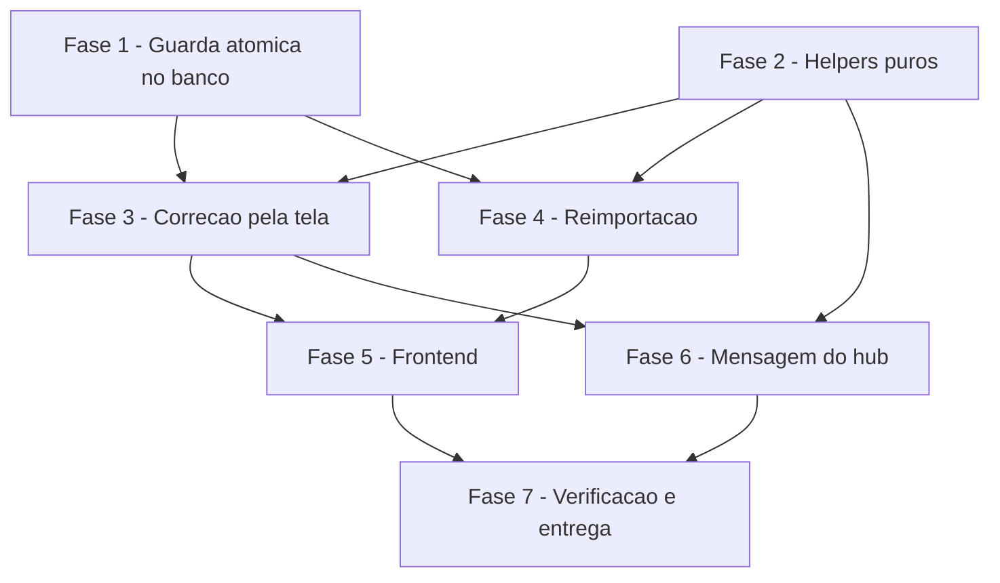

# Tarefas envioMassa - corrigir-movimento

Escopo: corrigir o valor de um movimento (`EnvioMassa`) antes do envio da nota, por reimportacao (lote) e pela tela, com guarda de nota enviada, auditoria atomica e mensagem coerente. Fontes: `spec.md` (FR-001..FR-025), `plan.md`, `contracts/correcao-valor-api.md`, `data-model.md`, `checklists/requirements.md`.

**Legenda de status:**
- `[ ]` Pendente
- `[~]` Em andamento
- `[x]` Concluido
- `[!]` Bloqueado

**Legenda de criticidade:**
- `[C]` Critico - Impacto financeiro direto ou bloqueante
- `[A]` Alto - Funcionalidade essencial
- `[M]` Medio - Necessario mas sem urgencia imediata

**Regras transversais (valem para TODA tarefa de teste e de helper):**
- **Controle negativo**: todo teste novo roda tambem SEM a correcao (codigo antigo / `git stash` da implementacao) e a tarefa registra **quais** testes falharam. Falhar "algum" nao basta: conferir que falham pelo motivo certo. Ja houve teste neste repo que afirmava o defeito.
- **Dedup antes de criar**: toda tarefa que cria helper registra o que procurou (grep) antes e reusa o existente: `toNumberBR` (`server.js:1210`), `buscarEmLotes` (`lib/hub-postgrest-lotes.js:29`), `resolveEmpresaAlvo` (`routes/grupo.js:831`), `toTimestamptzMidnightSP` (`server.js:1778`), `registrarAuditoria`, `renderizarMensagem` (`lib/adiantamento-mensagem.js`).
- **Gates com numeros** no fechamento de cada fase que tocar codigo: `node --test` do backend (passou/falhou), `tsc --noEmit` e `vitest` (frontend_v2), `next build` se tocar frontend, lint contra a baseline.
- **Sem commit/push/deploy** sem autorizacao por etapa do operador (rito do ciclo git). `git add` por caminho explicito, nunca `-A`.
- Nada de `req.body` repassado a escrita (SEC-1) e CNPJ no `in.()` so `onlyDigits`+`isCNPJ14` (SEC-2); `motivo` e texto de mensagem nunca vao para log (SEC-4).

---

## FASE 1 - Guarda atomica no banco (pre-condicao de toda escrita)

> User Story 3 (P1) e pre-condicao das US1/US2: a guarda existe ANTES de qualquer caminho de escrita. A guarda usa `nota_ok` preenchido E `erro_validacao` vazio, com `btrim` - **nunca** `numnota` (`nota_ok` e gravado ate em nota reprovada).

### 1.1 Levantamento e dedup `[A]`

Ref: plan.md Decisions 5/6/11; research.md.

- [x] 1.1.1 Ler `0109_*.sql` e `0098_*.sql` (padrao `SECURITY DEFINER`, `search_path`, `GRANT`, linha `ROLLBACK`) e registrar no corpo do commit/PR o que foi reusado
- [x] 1.1.2 Conferir no banco de teste (`hub-test-*`, recurso `hub_*`) se a tabela `EnvioMassa` existe (schema `0033`) e se `Auditoria` tem as colunas de `data-model.md`; se NAO existir, registrar bloqueio e devolver ao operador (nao improvisar fixture em producao)
- [x] 1.1.3 `grep` por funcao/rpc de correcao ja existente (`corrigir`, `movimento_valor`) para nao duplicar; registrar o que foi procurado
- [x] 1.1.4 Confirmar o proximo numero da serie em `infra/hub/migrations/` (hoje `0116`) imediatamente antes de criar o arquivo

### 1.2 Migration `hub_envio_massa_corrigir_valor` `[C]`

Ref: contracts §3; FR-015, FR-017, FR-019, FR-021..FR-024; INV-2, INV-9.

- [x] 1.2.1 Criar `infra/hub/migrations/0116_envio_massa_corrigir_valor.sql` (aditiva, idempotente, linha `ROLLBACK` no cabecalho, `GRANT EXECUTE` como as irmas); nunca editar migration ja aplicada
- [x] 1.2.2 Escopo: `WHERE id = ... AND id_empresa = p_id_empresa`; `id` de outra empresa devolve `nao_encontrado` (nao vaza existencia)
- [x] 1.2.3 Guarda de nota enviada no MESMO comando do `UPDATE` (`btrim(nota_ok)<>'' AND btrim(erro_validacao)=''`, NULL tratado como vazio) e guarda `mov_fechado = false`
- [x] 1.2.4 Alterar SOMENTE `valor`, `gorjeta`, `mensagem1`; iguais => `inalterado`, sem `UPDATE` e sem auditoria (FR-004)
- [x] 1.2.5 `INSERT INTO "Auditoria"` por movimento de fato alterado no mesmo comando (`acao='movimento_valor_corrigido'`, `usuario_id` NULL no legado, motivo integral sem mascarar); `msg_valor_antigo` na saida (FR-018)
- [x] 1.2.6 Aplicar via `migrate.sh` no ambiente de TESTE (`hub-test-*`) e registrar o resultado; aplicacao em producao NAO faz parte desta tarefa (rito de producao)

### 1.3 Teste da funcao com controle negativo `[C]`

Ref: SC-003, SC-004, SC-006, SC-008; FR-016, FR-017.

- [x] 1.3.1 Teste de integracao SQL (driver em `infra/hub/testes/`, padrao dos existentes) cobrindo: nota aprovada (pulado), nota reprovada (aceita), sem nota (aceita), `nota_ok` so espacos (vale vazio), `mov_fechado`, outra empresa (`nao_encontrado`), idempotencia (0 auditoria na 2a), autor NULL no legado e pessoa no hub, motivo preservado com numero tipo CNPJ/e-mail
- [x] 1.3.2 Teste de atomicidade: nota anexada entre a leitura e a gravacao nao e sobrescrita (duas sessoes concorrentes)
- [x] 1.3.3 CONTROLE NEGATIVO: rodar o mesmo driver contra uma versao da funcao SEM a guarda (e outra SEM o filtro de empresa) e anotar quais casos falham; cada defeito injetado tem de derrubar o caso correspondente, e so ele
- [x] 1.3.4 Gate: numero de PASS/FAIL do driver registrado; `git status` lido arquivo a arquivo

---

## FASE 2 - Helpers puros no backend

### 2.1 Levantamento e dedup `[A]`

- [x] 2.1.1 Procurar por helpers de: parse numerico de `valor`, normalizacao de CNPJ, substituicao de texto da mensagem, ja existentes (`grep` em `server.js`, `lib/`); registrar o que foi achado e reusar `toNumberBR`/`onlyDigits`/`isCNPJ14`
- [x] 2.1.2 Extrair `toNumberBR`+arredondamento de `server.js:1210-1238` para `lib/` SOMENTE se a extracao for necessaria para teste; manter `server.js` chamando a mesma funcao (um unico parser, FR-012)

### 2.2 Casamento e classificacao de linhas `[C]`

Ref: FR-001, FR-006, FR-007, FR-009; INV-11.

- [x] 2.2.1 Criar `lib/envio-massa-correcao.js` com funcao pura de casamento: ramo 1 `uuid` em memoria sobre o resultado da consulta; ramo 2 fallback `cnpj_prestador`+periodo; 0 candidatos = criar, 1 = atualizar, >1 = ambiguo; `uuid` NUNCA entra em query (SEC-2)
- [x] 2.2.2 Funcao pura de desfecho que garante `soma(desfechos) == total_linhas`
- [x] 2.2.3 Testes unitarios `node --test` incluindo `uuid` que casa, `uuid` inexistente caindo no fallback, linha sem `uuid`, ambigua, `uuid` instavel entre planilhas (NAO assumir estabilidade)
- [x] 2.2.4 CONTROLE NEGATIVO: rodar contra uma implementacao ingenua (so `uuid`, sem fallback) e anotar quais falham

### 2.3 Ajuste ancorado do texto da mensagem (origem planilha/tela) `[A]`

Ref: FR-014; plan Decision 4; Cenario 6 do quickstart.

- [x] 2.3.1 Funcao pura que substitui APENAS o numero logo apos a frase-ancora "valor total para emissao da NF"; devolve `{texto, ajustada}`; ancora ausente => `ajustada:false` (nunca sucesso presumido)
- [x] 2.3.2 Testes: nao toca gorjeta, CNPJ, CEP nem codigos que parecam `R$<numero>`; ancora duplicada; ancora ausente
- [x] 2.3.3 CONTROLE NEGATIVO: rodar contra substituicao ingenua por regex `R$<numero>` e anotar quais dos quatro casos de "numero errado" falham

---

## FASE 3 - Correcao pela tela (`PATCH /update-envio-massa/:id`)

> Depende da FASE 1 (guarda no banco). US2 + US3 + US4.

### 3.1 Backend: gravar de fato e devolver o desfecho real `[C]`

Ref: contracts §2; FR-011..FR-014, FR-019, FR-020; SEC-1, SEC-3, SEC-4; causa raiz `server.js:1050-1057`.

- [x] 3.1.1 Allowlist LITERAL (`valor`, `gorjeta`, `mensagem1`) para o que vai a funcao; proibido `req.body` repassado ou em spread (SEC-1); `empresa_id` so via `resolveEmpresaAlvo` (SEC-3)
- [x] 3.1.2 `motivo` obrigatorio e nao vazio (400 antes de qualquer escrita); `valor` validado pelo mesmo `toNumberBR` da importacao (400 se invalido)
- [x] 3.1.3 Chamar a RPC da FASE 1 e mapear desfechos: `200 atualizado` (+`mensagem_ajustada`/`aviso`), `409 pulado_nota_enviada`, `409 pulado_mov_fechado`, `404 nao_encontrado`, `500` em falha - nunca "atualizado com sucesso" sem gravar
- [x] 3.1.4 Manter o comportamento atual de `men1`/`men2`/`cnpj_prestador` intacto (regressao); `motivo` e texto de mensagem fora de qualquer `console.*` (SEC-4)

### 3.2 Testes do caminho da tela com controle negativo `[C]`

Ref: SC-002, SC-006, SC-007; CHK019.

- [x] 3.2.1 Testes de rota (`node --test`): grava e relê o valor, sem motivo (400), valor nao numerico (400), nota enviada (409 e valor preservado), nota reprovada (aceita), fechado (409), outra empresa (404), falha de RPC (500 sem sucesso), permissao `envio_massa.criar` ausente (recusa)
- [x] 3.2.2 Mass assignment: corpo com `numnota`, `nota_ok`, `erro_validacao`, `mov_fechado`, `dt_inicial`, `id_empresa` NAO altera nada alem de `valor`/`gorjeta`/`mensagem1`
- [x] 3.2.3 CHK019 - isolamento: a `EnvioMassa` NAO tem RLS (so `GRANT`), logo o filtro de `id_empresa` e a UNICA protecao de tenant; teste de isolamento por query que falha se o filtro for removido, e comentario no codigo declarando a premissa
- [x] 3.2.4 CONTROLE NEGATIVO: rodar a suite contra o `server.js` ANTIGO (valor fora do `updateData`) e anotar quais falham - deve falhar justamente o "grava e relê" e o "nao confirma sem gravar"; confirmar que nenhum teste pre-existente AFIRMA o defeito (se afirmar, corrigir e declarar no commit)

---

## FASE 4 - Reimportacao (`POST /upload`)

> Depende das FASES 1 e 2. US1 + US3 + US4.

### 4.1 Backend: reconhecer antes de inserir `[C]`

Ref: contracts §1; FR-001..FR-010; SEC-2; plan Decisions 1-3, 9-11.

- [x] 4.1.1 `buscarEmLotes` ganha `fetcher` opcional (cliente injetado, Decision 11) sem quebrar chamadores atuais; teste dos chamadores existentes
- [x] 4.1.2 Consulta de casamento em lotes de 100 CNPJs, `id_empresa` explicito, periodo em FAIXA (`>=d` e `<d+1`), nunca `::date`; lista do `in.()` so de valores `onlyDigits`+`isCNPJ14` (SEC-2)
- [x] 4.1.3 CHK021 - importacao SEM range: o contrato ja exige `dt_inicial`/`dt_final` (400 antes de tudo); teste prova 400 sem consulta e sem escrita e que NAO existe fallback silencioso sem periodo; se o teste mostrar comportamento diferente, abrir bloqueio
- [x] 4.1.4 `motivo` obrigatorio SOMENTE se o lote alteraria existentes; recusado antes de qualquer alteracao (FR-008)
- [x] 4.1.5 Linha invalida => nada criado nem atualizado (FR-005, tudo-ou-nada preservado); ambigua => aplica o resto e lista (FR-006, mudanca deliberada)
- [x] 4.1.6 Criar as linhas novas como hoje (FR-002) e atualizar as existentes via RPC em lote (so `valor`/`gorjeta`/`mensagem1` - texto vem da planilha, FR-003)
- [x] 4.1.7 Resposta com `resumo` (7 desfechos + `mensagem_valor_antigo`) e listas `ambiguos`/`pulados`; soma == `total_linhas` (INV-11)
- [x] 4.1.8 Falha no meio: resumo preciso do que foi e nao foi aplicado, nunca sucesso total

### 4.2 Testes de reimportacao com controle negativo e desempenho `[C]`

Ref: SC-001, SC-003..SC-005, SC-008; CHK019.

- [x] 4.2.1 Testes: reimportar nao cresce o total (0 duplicatas); 2a importacao identica = 0 alteracoes e 0 auditorias; linhas novas criadas + existentes atualizadas; nota enviada contada exatamente; fechado contado; ambigua listada; sem `uuid` cai no fallback; `uuid` inexistente cai no fallback; sem motivo recusado
- [x] 4.2.2 Isolamento: lote da empresa A com CNPJ/`uuid` de movimento da empresa B nao altera B
- [x] 4.2.3 Desempenho: lote sintetico de ~980 linhas; medir numero de requisicoes (sem consulta por linha, FR-010) e tempo total contra o teto de 10 s; registrar os numeros
- [x] 4.2.4 CONTROLE NEGATIVO: rodar contra o `/upload` ANTIGO (INSERT cego) e anotar quais falham - devem cair os de duplicacao/idempotencia; verificar que nenhum teste existente afirma o INSERT cego
- [x] 4.2.5 Gate da fase: `node --test` backend completo com numeros (passou/falhou) e comparacao com a baseline

---

## FASE 5 - Frontend

> Depende de 3.1 e 4.1 (contrato estavel).

### 5.1 Tela de edicao e de importacao `[A]`

Ref: FR-008, FR-009, FR-011, FR-013, FR-018; `hooks/use-envio-massa.ts:97-101`.

- [x] 5.1.1 ANTES de propor UI nova: abrir as telas que ja mostram edicao/importacao de movimento e registrar, na proposta, onde essa informacao aparece hoje (regra do CLAUDE.md); reusar componentes e vocabulario existentes
- [x] 5.1.2 `updateRecord` envia `valor` e `motivo`; campo de motivo obrigatorio na edicao; exibir o desfecho REAL (inclui `aviso` de mensagem nao ajustada, 409 orientando cancelar a nota antes, 404, 500) e nunca "atualizado com sucesso" sem gravacao
- [x] 5.1.3 Importacao: campo de motivo (exigido quando o lote altera existentes) e painel de resumo com os desfechos, ambiguos e pulados
- [x] 5.1.4 Testes `vitest` (hook + componentes) e CONTROLE NEGATIVO contra o hook antigo, anotando quais falham
- [x] 5.1.5 Gates com numeros: `tsc --noEmit`, `vitest`, lint contra a baseline, `next build` (conferir `df -h /` >= ~20 GB e swap antes; `--memory=2g`), detector impeccable 0 achados
- [x] 5.1.6 Conferir e reverter `package-lock.json` se tiver sido reescrito por container de E2E antes de qualquer commit

---

## FASE 6 - Mensagem de movimento gerado pelo hub (CHK025)

> Prioridade BAIXA: hoje nenhum movimento do hub existe em producao (`ApuracaoRepasse` = 0 linhas em 19/10). Precaucao para quando o fechamento for usado; precisa existir e ser testavel, nao e a primeira entrega. Depende de 2.3 e 3.1.

### 6.1 Re-renderizar o molde em vez de procurar frase `[M]`

Ref: `lib/adiantamento-mensagem.js` (`PLACEHOLDERS_PERMITIDOS` conjunto fechado), `lib/adiantamento-geracao-movimento.js:189-190`, molde em `AdiantamentoConfiguracao`; FR-014.

- [x] 6.1.1 Levantamento: confirmar como distinguir movimento do hub de movimento de planilha (e quais dados - nome, periodo, total - permitem re-render); registrar o que foi procurado
- [x] 6.1.2 Verificacao deterministica antes de usar: renderizar o molde ATUAL com os valores ANTIGOS e comparar com `mensagem1` gravada; so se forem iguais renderizar com o valor corrigido (`mensagem_ajustada:true`); se diferirem (molde editado depois), tratar como mensagem nao reconhecivel e AVISAR - sem regex, sem acertar a gorjeta por engano
- [x] 6.1.3 Testes: movimento do hub re-renderizado; molde alterado apos a geracao => aviso; movimento de planilha segue pelo caminho ancorado (2.3)
- [x] 6.1.4 CONTROLE NEGATIVO: rodar contra o caminho ancorado puro (frase ausente) e anotar que falha ao ajustar a mensagem do hub

---

## FASE 7 - Verificacao final e entrega

### 7.1 Pendencia do OPERADOR antes do deploy (CHK022) `[C]`

Ref: SC-005; plan Decision 2; CHK022, CHK026. NAO e tarefa de implementacao do agente: a `EnvioMassa` vive em producao e nenhum ambiente do agente a tem.

- [x] 7.1.1 [entregue como pendencia: CHK022 cumprido em hub_homolog (onda-008); conferencia no chatmasterveloz = OPERADOR antes do deploy (RUNBOOK-DEPLOY.md)] OPERADOR: rodar `EXPLAIN (ANALYZE, BUFFERS)` da consulta de casamento (Cenario 12 do quickstart) no `chatmasterveloz` e anexar o resultado
- [x] 7.1.2 [entregue como pendencia: condicional ao 7.1.1, OPERADOR] Se o indice `idx_envio_massa_cnpj_periodo` nao for usado/for lento: ativar a alternativa B `(id_empresa, dt_inicial, dt_final)` (migration propria, aditiva); decisao do indice permanece em score 2 ate a medicao
- [x] 7.1.3 [entregue como pendencia: OPERADOR] OPERADOR confirma a procedencia das medicoes das planilhas e do inventario de indices (CHK026) e decide CHK023/CHK024 (apetite do corte "so aberto"; reenvio automatico vs aviso)

### 7.2 Gates de seguranca e revisao `[A]`

- [x] 7.2.1 Releitura do diff contra SEC-1 (allowlist), SEC-2 (`in.()` so CNPJ validado, `uuid` fora de query), SEC-3 (`p_id_empresa` vindo de `resolveEmpresaAlvo`), SEC-4 (sem log de motivo/mensagem)
- [x] 7.2.2 Revisao independente sobre o diff ANTES do PR (auto-verificacao em ondas nao pega o ponto cego do autor)
- [x] 7.2.3 Smoke dos cenarios do `quickstart.md` aplicaveis ao ambiente de teste, com numeros

### 7.3 Entrega ao operador `[A]`

- [x] 7.3.1 Artefatos para o operador: migration, runbook de aplicacao (migration ANTES do codigo, DDL+`SchemaMigration` na mesma transacao, SIGUSR1 no `pgadmin_postgrest`), plano de rollback (imagem anterior + `DROP FUNCTION`)
- [x] 7.3.2 [entregue como pendencia: OPERADOR, rito do repo] Branch `<tipo>/<escopo>-<slug>`, commit/PR so com autorizacao por etapa; build a partir da `main` mergeada, tag `<rotulo>-<sha7>`, prova de bundle pela string servida (rito, executado pelo operador)

---

## Matriz de Dependencias

## Resumo Quantitativo

| Fase | Tarefas | Subtarefas | Criticidade |
|------|---------|------------|-------------|
| 1 - Guarda atomica no banco (pre-condicao de toda escrita) | 3 | 14 | C |
| 2 - Helpers puros no backend | 3 | 9 | C |
| 3 - Correcao pela tela (`PATCH /update-envio-massa/:id`) | 2 | 8 | C |
| 4 - Reimportacao (`POST /upload`) | 2 | 13 | C |
| 5 - Frontend | 1 | 6 | A |
| 6 - Mensagem de movimento gerado pelo hub (CHK025) | 1 | 4 | M |
| 7 - Verificacao final e entrega | 3 | 8 | C |
| **Total** | **15** | **62** | - |

## Escopo Coberto

| Item | Descricao | Fase |
|------|-----------|------|
| FR-015..FR-017, FR-019, FR-021..FR-024 | Guarda de nota enviada, escopo de empresa, auditoria atomica (funcao no banco) | 1 |
| FR-001, FR-006, FR-007, FR-009, FR-012, FR-014 | Casamento, classificacao, parser unico, ajuste ancorado da mensagem | 2 |
| FR-011..FR-014, FR-020, SEC-1, SEC-3 | Correcao pela tela com desfecho real e allowlist | 3 |
| FR-001..FR-010, FR-018, SEC-2, CHK019, CHK021 | Reimportacao sem duplicar, resumo, desempenho | 4 |
| FR-008, FR-009, FR-013 | UI de edicao e importacao | 5 |
| CHK025 | Mensagem de movimento gerado pelo hub por re-render do molde | 6 |
| CHK022, CHK023, CHK024, CHK026 | Pendencias do operador, gates, entrega | 7 |

## Escopo Excluido

| Item | Descricao | Motivo |
|------|-----------|--------|
| FR-025 | Reabrir/recalcular apuracao de repasse, calculo do valor, origem/layout da planilha | Fora de escopo declarado na spec |
| Indice novo | Criar indice em `EnvioMassa` | Decision 2: nenhum ate o EXPLAIN do operador reprovar (alternativa B em 7.1.2) |
| RLS em `EnvioMassa` | Alterar modelo de acesso/GRANTs | Decisao do plano; filtro explicito e a protecao (3.2.3) |
| Log pre-existente (`server.js:2035`) | Reduzir PII no log da primeira linha | Pre-existente (SEC-4), fora de escopo |
| Reenvio automatico de mensagem | Reenviar ao motorista apos correcao | Spec so exige aviso (FR-018); CHK024 e decisao do operador |

## FASE 8 - Convergência

> Fase gerada automaticamente pela skill `converge` (reconciliação
> spec-vs-código). Cada tarefa abaixo corresponde a um achado (`Gap`)
> entre o que `spec.md`/`plan.md`/`tasks.md` descreveram e o estado
> presente do código. Tarefas sem o prefixo `[Revisar]` são acionáveis
> (`missing`/`partial`/`contradicts`); tarefas com `[Revisar]` são item de
> revisão (`unrequested`, FR-013) — nunca "implementar", o código já
> existe. Append-only: esta fase nunca reescreve fases/tarefas anteriores
> do arquivo (FR-009).

### 8.1 Runbook declara 4 das mudancas de comportamento em caminho vivo, nao todas `[A]`

Ref: 7.3.1 · tipo: `partial` · severidade: `MEDIUM`

A tarefa 7.3.1 exige o runbook de entrega ao operador; `docs/specs/corrigir-movimento/RUNBOOK-DEPLOY.md` entrega ordem (migration -> `SIGUSR1` -> codigo), rollback (imagem anterior + `DROP FUNCTION`) e prova de bundle — tudo presente e correto. A secao `## Mudancas de comportamento em caminho vivo (declarar no PR)` lista 4 itens, mas ao menos uma mudanca verificada no codigo nao esta declarada:

1. **`mensagem1` passa a ser reescrita automaticamente** quando o valor e corrigido pela tela: `corrigirPelaTela` faz `if (aj.ajustada) mov.mensagem1 = aj.texto` (`app_homologacao/backend/lib/envio-massa-correcao.js`), e a RPC grava a coluna. Antes, editar valor nunca tocava `mensagem1` (o valor nem era gravado). O texto e o que o motorista recebe — mudanca visivel ao cliente final, logo tem de ser declarada no PR.
2. Candidato adicional a declarar (ou a fundir explicitamente com os itens 3/4 da lista): `POST /upload` passa a responder **400 exigindo `motivo`** quando o lote alteraria movimentos existentes (`reimportar`: `if (alteraria && !motivoT)`). Um reenvio de planilha que antes passava (duplicando) agora e recusado.

Completar e **aditivo**: acrescentar a(s) linha(s) a secao existente do runbook, sem alterar nenhuma decisao ja tomada nem nenhum codigo.

- [x] 8.1.1 Completar a secao `## Mudancas de comportamento em caminho vivo` de `docs/specs/corrigir-movimento/RUNBOOK-DEPLOY.md` conforme `7.3.1`: acrescentar a reescrita automatica de `mensagem1` e decidir se o 400 por `motivo` no `/upload` entra como item proprio ou nota dos itens existentes

<!-- converge-key: 1aa119e9285b -->
