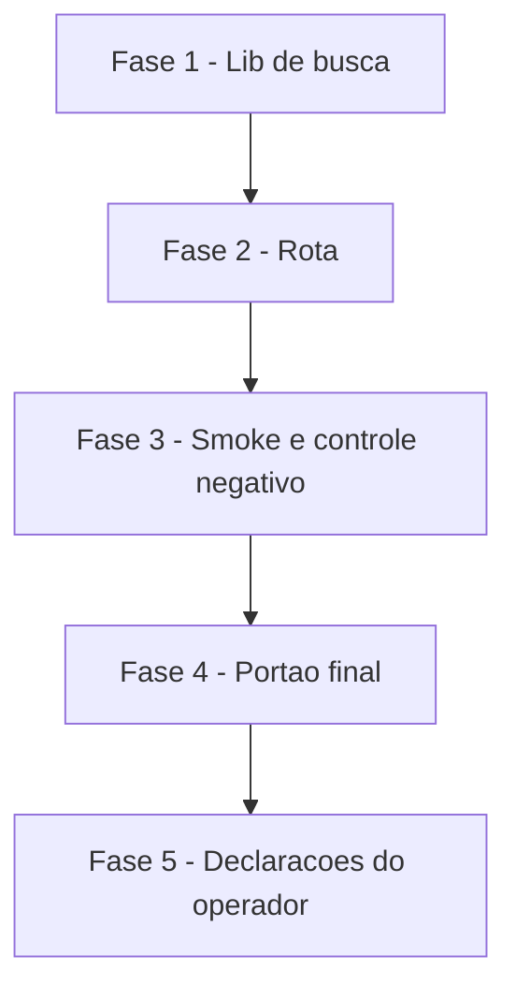

# Tarefas filtro-banco-motorista - Busca de banco pelo nome que o motorista conhece

Escopo: tornar `GET /bancos` (app motorista) tolerante a acento e a nome comercial (Nubank, PicPay, Inter, C6, Mercado Pago), com busca em 4 tiers, mantendo o contrato `{codigo, nome}`. Backend-only: `lib/bancos-busca.js` (novo), rota `routes/motorista-adiantamento.js:733-738`, dois testes novos e registro no script `test`. Sem migration, sem banco, sem mudanca no frontend. Tier de entrega usado na geracao deste backlog: nao informado (backlog completo; nao ha fase de infra de producao).

**Legenda de status:**
- `[ ]` Pendente
- `[~]` Em andamento
- `[x]` Concluido
- `[!]` Bloqueado

**Legenda de criticidade:**
- `[C]` Critico - Impacto financeiro direto ou bloqueante
- `[A]` Alto - Funcionalidade essencial
- `[M]` Medio - Necessario mas sem urgencia imediata

Caminhos relativos a `app_homologacao/backend/` salvo indicacao. Regras de seguranca vindas do gate (obrigatorias em toda tarefa que toca `q`): preservar `typeof q === 'string'`; PROIBIDO `mapa[q]` e `q in mapa`; sem `RegExp` construida a partir de `q`; cap de 60 caracteres; `q` fora do log; `ispb` fora do payload.

**Classificacao dos casos de teste (vale para FASE 1 e FASE 3):** `nubank`, `itau` e `nu` PROVAM a correcao (devem falhar contra o codigo atual). `mercado pago`, `260`, `banco` e termo vazio sao GUARDAS de nao-regressao: passam antes e depois e NAO contam como prova.

---

## FASE 1 - Fonte unica de apelidos e normalizacao (lib)

### 1.1 Preparar branch e conferir baselines `[A]`

Ref: plan.md "Ordem de implementacao" 1; "Gates" (baselines 82 pass/0 fail e 1941 pass/0 fail)

- [x] 1.1.1 Criar a branch `fix/filtro-banco-motorista` a partir da `main` atualizada (nunca commitar na `main`; NAO commitar nesta execucao, o ciclo git e do command pai)
- [x] 1.1.2 Rodar `node --test tests/adiantamento-bancos-compe-unit.test.js tests/motorista-adiantamento-rotas-unit.test.js` e confirmar a baseline 82 pass / 0 fail
- [x] 1.1.3 Rodar `npm test` e confirmar a baseline 1941 pass / 0 fail; registrar os numeros, pois qualquer `fail` depois da mudanca e regressao

### 1.2 Criar `lib/bancos-busca.js` com `APELIDOS_BANCOS` e `normalizarTermo` `[A]`

Ref: plan.md "Interface de lib/bancos-busca.js"; data-model.md "Nome comercial"; spec.md FR-002, FR-003, FR-009

- [x] 1.2.1 Criar o modulo e declarar `APELIDOS_BANCOS` como fonte unica (nunca redeclarar em outro lugar): `nubank`->`['260']`, `mercado pago`->`['323']`, `picpay`->`['380','079','469']`, `inter`->`['077']`, `c6`->`['336','626']`, chaves ja normalizadas
- [x] 1.2.2 Importar `normalizarNome` de `lib/hub-motoristas-dto.js` (definida na linha 56, exportada na 664) e NAO criar segunda implementacao de remocao de acento (FR-009)
- [x] 1.2.3 Implementar `normalizarTermo(texto)`: cap de 60 caracteres antes de qualquer trabalho, depois `normalizarNome`, depois colapso de espacos internos (`mercado  pago` equivale a `mercado pago`; o helper so faz trim)
- [x] 1.2.4 Em `normalizarTermo`, devolver `''` quando o termo nao tiver nenhum caractere alfanumerico (guarda para `´` U+00B4, que nao e marca combinante e sobrevive ao NFD; sem isso um acento solto devolveria 0 itens onde a spec exige 20)
- [x] 1.2.5 Exportar `APELIDOS_BANCOS` e `normalizarTermo` (o teste de invariante do mapa precisa dos dois)

### 1.3 Implementar `buscarBancos` com 4 tiers, dedup e teto `[A]`

Ref: plan.md "Os 4 tiers", "Termo inteiro, nunca fragmentado"; spec.md FR-001, FR-004, FR-005, FR-006, FR-007

- [x] 1.3.1 Implementar `buscarBancos(todos, termo, limite = 20)` recebendo a lista por parametro (sem `require` da fixture dentro da lib)
- [x] 1.3.2 Termo normalizado vazio devolve os primeiros `limite` itens de `todos`, no formato atual (FR-007)
- [x] 1.3.3 T0: `codigo.startsWith(termo)`; T1: termo e PREFIXO de um apelido, devolvendo os codigos na ordem declarada no mapa; T2: nome normalizado comeca com o termo; T3: nome normalizado contem o termo; desempate interno de T0/T2/T3 = ordem da fixture
- [x] 1.3.4 Percorrer o mapa por iteracao (`Object.keys`/`Object.entries` com `startsWith`), NUNCA `mapa[q]` nem `q in mapa`; sem `RegExp` construida de `q`; termo tratado inteiro, sem tokenizar nem n-gramas (FR-006)
- [x] 1.3.5 Dedup: cada banco aparece uma unica vez, no melhor tier em que se qualificou; concatenar tiers e cortar em `limite`
- [x] 1.3.6 Devolver os objetos da fixture sem alterar codigo nem nome (FR-003); a projecao `{codigo, nome}` fica na rota

### 1.4 Teste unitario `tests/bancos-busca-unit.test.js` `[A]`

Ref: plan.md "Rastreabilidade - FR/SC -> teste" (coluna U)

- [x] 1.4.1 Criar o arquivo com `node:test`, usando a fixture real e listas sinteticas pequenas para tiers e dedup
- [x] 1.4.2 Casos de marca e acento: `nubank`->260; `itau` e `itaú` ambos `[341, 479]` com 341 antes de 479; `mercado pago`->323; `picpay`->380,079,469 nessa ordem; `inter`->077 em 1o; `c6`->336,626; `nu`->260 em 1o
- [x] 1.4.3 Casos de codigo e termo generico: `260`->1 item; `60`->604,600 e NAO 260; `banco`->20 itens e todo item contem a SUBSTRING "banco" (nao a palavra: `081 BANCOSEGURO S.A.` entra)
- [x] 1.4.4 Casos de vazio e robustez: `''`, `'   '` e `'´'`->20 itens; `mercado  pago` (espaco duplo) igual a `mercado pago`; termo de 200 caracteres nao estoura e e tratado como os 60 primeiros
- [x] 1.4.5 Casos hostis ao mapa: `constructor` e `__proto__` nao lancam e devolvem lista valida (nada de 500), cobrindo a proibicao de `mapa[q]` e `q in mapa`
- [x] 1.4.6 Invariantes do mapa: todo codigo de `APELIDOS_BANCOS` existe na fixture; toda chave ja esta normalizada (`normalizarTermo(chave) === chave`); `normalizarTermo` delega a `normalizarNome` importado (sem segunda implementacao)
- [x] 1.4.7 FR-003: cada item devolvido e identico (codigo e nome) a entrada da fixture; rodar `node --test tests/bancos-busca-unit.test.js` e conferir 100% verde (testes unitarios da lib nova sao positivos; o controle negativo e da FASE 3)

---

## FASE 2 - Rota `GET /bancos` delegando a lib

### 2.1 Trocar o corpo da rota por chamada a `buscarBancos` `[A]`

Ref: routes/motorista-adiantamento.js:733-738; plan.md "Divisao de responsabilidade"; spec.md FR-008

- [x] 2.1.1 Adicionar `require('../lib/bancos-busca')` no bloco de imports do router, junto do `require` da fixture (linha 40, que permanece na rota)
- [x] 2.1.2 Reescrever o handler preservando o guard `typeof req.query.q === 'string'` (array de `?q=a&q=b` e objeto de `?q[x]=1` viram termo vazio, nunca 500)
- [x] 2.1.3 Chamar `buscarBancos(bancosFixture.bancos || [], q)` e responder `res.json({ itens: ...map(b => ({ codigo: b.codigo, nome: b.nome })) })`, mantendo `ispb` fora do payload (FR-008)
- [x] 2.1.4 Nao logar `q` em lugar nenhum e nao introduzir `RegExp` nem acesso a mapa por chave vinda da requisicao
- [x] 2.1.5 Rodar a nao-regressao `node --test tests/adiantamento-bancos-compe-unit.test.js tests/motorista-adiantamento-rotas-unit.test.js` e conferir 82 pass / 0 fail (o `deepEqual` de `q=260` continua identico)

---

## FASE 3 - Smoke HTTP com controle negativo

### 3.1 Escrever `tests/motorista-bancos-smoke.test.js` `[A]`

Ref: quickstart.md Cenarios 1 e 2; plan.md "Rastreabilidade" (coluna S); spec.md FR-010, SC-001, SC-005

- [x] 3.1.1 Montar app com `express` + o router REAL de `routes/motorista-adiantamento.js` (o plan mediu que o router boota puro), `listen(0)` e chamadas por `fetch`, SEM mock da rota nem da busca; fechar o servidor no `after`
- [x] 3.1.2 Casos que PROVAM a correcao: `nubank` -> `260`; `itau` -> `341` presente e antes de `479`; `nu` -> `260` em 1o lugar
- [x] 3.1.3 Casos GUARDA de nao-regressao (passam antes e depois): `mercado pago` -> `323`; `260` -> `deepEqual` exato do item atual; `banco` -> 20 itens, todos com a substring "banco"; termo vazio e `'´'` -> 20 itens
- [x] 3.1.4 Casos de borda HTTP: `?q=a&q=b` e `?q[x]=1` respondem 200 com lista (nao 500); `?q=constructor` e `?q=__proto__` respondem 200; cada item tem exatamente `{codigo, nome}` (sem `ispb`)
- [x] 3.1.5 Emitir tabela PASS/FAIL dos 7 casos e fazer o processo sair com codigo nao-zero se qualquer um reprovar (SC-005)

### 3.2 Controle negativo contra a rota ANTIGA `[C]`

Ref: spec.md FR-010 e SC-002; quickstart.md Cenario 1; memoria "controle negativo pega teste oco"

- [x] 3.2.1 Salvar o diff da rota (`git diff -- routes/motorista-adiantamento.js > /tmp/rota-nova.patch`) e restaurar SOMENTE esse arquivo ao estado de `HEAD` (`git checkout HEAD -- routes/motorista-adiantamento.js`), sem tocar em mais nada
- [x] 3.2.2 Rodar `node --test tests/motorista-bancos-smoke.test.js` e conferir, NOME POR NOME, que falham exatamente `nubank`, `itau` e `nu`, e que `mercado pago`, `260`, `banco` e vazio PASSAM (sao guardas, nao provas); se falhar outro conjunto, o teste esta oco ou errado: corrigir antes de seguir
- [x] 3.2.3 Reaplicar a rota nova (`git apply /tmp/rota-nova.patch`) e confirmar que `git diff --stat` volta a mostrar a rota alterada
- [x] 3.2.4 Rodar o smoke de novo contra a rota nova e conferir 7/7 PASS; anotar na saida da tarefa os dois resultados (antes: 3 FAIL nomeados + 4 PASS; depois: 7 PASS)

### 3.3 Registrar os dois testes novos no script `test` `[A]`

Ref: plan.md "package.json" (o script lista arquivos um a um); scripts/checar-testes-orfaos.js

- [x] 3.3.1 Acrescentar `tests/bancos-busca-unit.test.js` e `tests/motorista-bancos-smoke.test.js` ao script `test` do `package.json`, sem reordenar nem remover entradas existentes
- [x] 3.3.2 Conferir que os dois rodam ISOLADOS (`node --test <arquivo>`) e DENTRO do `npm test` (o total sobe em relacao aos 1941 e nenhum `fail` aparece)

---

## FASE 4 - Portao final (numeros relatados)

### 4.1 Rodar o portao completo e relatar numeros `[A]`

Ref: plan.md "Gates"; quickstart.md Cenarios 4 e 5

- [x] 4.1.1 Unit da lib: `node --test tests/bancos-busca-unit.test.js` com contagem de pass/fail
- [x] 4.1.2 Smoke HTTP: `node --test tests/motorista-bancos-smoke.test.js` com 7/7 e a tabela PASS/FAIL
- [x] 4.1.3 Nao-regressao: `node --test tests/adiantamento-bancos-compe-unit.test.js tests/motorista-adiantamento-rotas-unit.test.js` = 82 pass / 0 fail
- [x] 4.1.4 Suite completa `npm test` sem nenhum `fail` (baseline 1941 pass / 0 fail; vermelho e regressao desta entrega, nao falha herdada)
- [x] 4.1.5 Orfaos: `node scripts/checar-testes-orfaos.js` sem pendencia (pega teste novo fora do script `test`)
- [x] 4.1.6 Qualquer reprovado: corrigir e REINICIAR o portao do zero (suite completa, nao so o caso que falhou)
- [x] 4.1.7 Conferir `git status` arquivo a arquivo: so `lib/bancos-busca.js`, a rota, os dois testes, `package.json` e os artefatos da spec; `package-lock.json` e untracked alheios intocados. Nao rodam nesta frente: `next build`, eslint do app motorista, E2E do hub, tsc/lint do backend

---

## FASE 5 - Verificacoes e declaracoes do operador (humano)

### 5.1 Confirmar a ordem do apelido `picpay` (CHK037) `[M]`

Ref: checklists/busca-api.md CHK037; plan.md tabela de tiers; data-model.md invariante 3

- [ ] 5.1.1 Apresentar ao operador a ordem atual `380, 079, 469` (score 2, fundamentada no nome oficial: `469 PICPAY INVEST` e DTVM, nao quem recebe repasse)
- [ ] 5.1.2 Registrar a resposta do operador; se a ordem mudar, o custo e 1 linha em `APELIDOS_BANCOS` mais o ajuste do caso `picpay` no unit
- [ ] 5.1.3 Sem resposta, manter `380, 079, 469` e declarar no PR que a ordem e decisao de score 2 nao confirmada (nao bloqueia)

### 5.2 Declarar que `banco <marca>` devolve 0 itens (CHK038) `[M]`

Ref: checklists/busca-api.md CHK038; plan.md "Limitacao conhecida (medida)"; spec.md FR-006

- [ ] 5.2.1 Declarar no PR que `banco nubank`, `banco c6`, `banco itau`, `banco picpay` e `banco mercado pago` devolvem 0 itens (so `banco inter` acha, por acidente), consequencia de FR-006, NAO implementado
- [ ] 5.2.2 Registrar o custo se o operador quiser: 1 linha (stopword `banco ` inicial) mais um caso de teste
- [ ] 5.2.3 Nao implementar nada para este item sem pedido do operador

### 5.3 Declarar as duas emendas de spec no PR (CHK039) `[M]`

Ref: checklists/busca-api.md CHK039; spec.md FR-010 e SC-002

- [ ] 5.3.1 Citar no corpo do PR a emenda (a): `mercado pago` reclassificado como GUARDA (ja passava) e `nu` reprovado por POSICAO (ja devolvia 9 itens, mas com `360` em 1o)
- [ ] 5.3.2 Citar a emenda (b): a asserção de `banco` e de SUBSTRING, nao de palavra (`081 BANCOSEGURO S.A.` entra)
- [ ] 5.3.3 Incluir no PR os numeros do portao (FASE 4) e o resultado do controle negativo (FASE 3.2), e declarar o que ficou de fora (frontend, `banco <marca>`)

---

## Matriz de Dependencias

## Resumo Quantitativo

| Fase | Tarefas | Subtarefas | Criticidade |
|------|---------|------------|-------------|
| 1 - Fonte unica de apelidos e normalizacao (lib) | 4 | 21 | A |
| 2 - Rota GET /bancos | 1 | 5 | A |
| 3 - Smoke HTTP com controle negativo | 3 | 11 | C/A |
| 4 - Portao final | 1 | 7 | A |
| 5 - Verificacoes e declaracoes (humano) | 3 | 9 | M |
| **Total** | **12** | **53** | - |

## Escopo Coberto

| Item | Descricao | Fase |
|------|-----------|------|
| FR-001, FR-009 | Acento ignorado nos dois lados; reuso de `normalizarNome` sem segunda implementacao | 1 |
| FR-002, FR-003 | Apelidos Nubank, PicPay, Inter, C6, Mercado Pago como camada de busca; fixture intocada | 1 |
| FR-004, FR-005, FR-006, FR-007 | Tiers de relevancia, codigo por prefixo, termo inteiro, vazio devolve 20 | 1 |
| FR-008 | Contrato `{codigo, nome}` preservado, `ispb` fora do payload | 2 |
| FR-010, SC-001, SC-002, SC-005 | Smoke de 7 casos com controle negativo e saida non-zero | 3 |
| SC-004 | Zero regressao (82 pass e 1941 pass) | 4 |
| CHK037, CHK038, CHK039 | Tres itens humanos do checklist, como verificacao/declaracao | 5 |
| Seguranca | `typeof q`, sem `mapa[q]`/`in`, sem RegExp de `q`, cap 60, `q` fora do log | 1, 2, 3 |

## Escopo Excluido

| Item | Descricao | Motivo |
|------|-----------|--------|
| Frontend do app motorista | Nenhuma mudanca em `frontend_motorista` | Contrato inalterado (FR-008); medido no plan |
| Stopword `banco <marca>` | Busca `banco nubank` continua com 0 itens | Ninguem pediu; custo de 1 linha declarado (CHK038) |
| Reescrita da fixture de bancos | `bancos-compe.json` nao e alterada | Proibido por FR-003 |
| `next build`, eslint do app, E2E do hub, tsc/lint do backend | Gates que nao rodam | Nada tocado nessas camadas ou nao existe baseline (plan.md "Gates") |
| Deploy, build de imagem, commit, PR | Ciclo git e producao | Do command pai, com autorizacao do operador por etapa |
