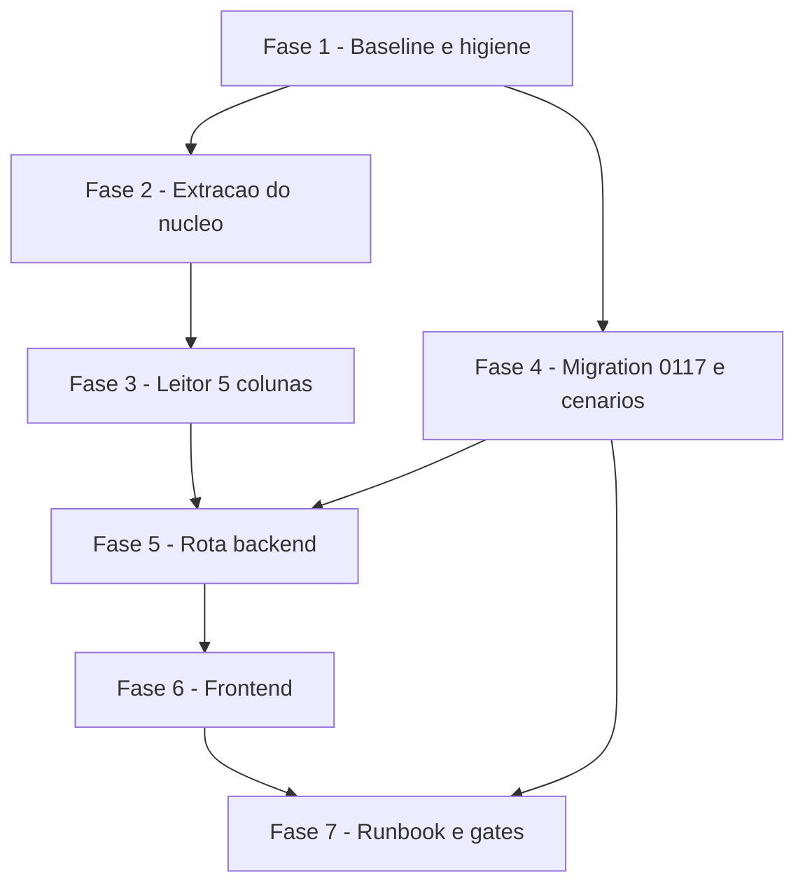

# Tarefas lancamento-externo - Importar pagos por fora (lancamento externo)

Escopo: backlog da feature `lancamento-externo` (spec.md, plan.md, research.md, data-model.md,
quickstart.md, contracts/import-lancamento-externo.md, checklists/requirements.md). Cobre: extracao
do nucleo XLSX com rede de nao-regressao, leitor de 5 colunas, edicao da migration 0117 (ainda NAO
em producao, so no `hub_homolog` isolado), rota de import + resumo, botao/dialogo e aviso FR-049,
e o fechamento dos 8 itens abertos do checklist (todos viram tarefa; nenhum e "risco aceito").

**Restricoes que valem para TODAS as tarefas**
- "Homologacao" E producao: nenhuma tarefa toca o ambiente vivo. A 0117 e aplicada **somente** no
  `hub_homolog`/`hub-test-*` (excecao `hub-*` do CLAUDE.md). Aplicar em producao e do **operador** (FR-044).
- **Nao commitar, nao `git add`** nesta entrega. Repositorio **publico** (FR-043).
- **Nao rodar `docker build`** (disco ~22 GB, limite ~20 GB; `df -h /` antes de qualquer coisa pesada).
- **Todo arquivo de teste novo entra em `backend/package.json:8`** (hoje 88 arquivos listados um a um) ou o
  verde e oco. Cada tarefa que cria teste tem esse passo como subtarefa propria.
- Teste antes da edicao sempre que possivel, com **controle negativo nomeado** (SC-011): rodar SEM a
  correcao, anotar QUAIS testes falham (nao so "algum falha"), reaplicar, ver passar.
- Linhas citadas como `arquivo:N` foram lidas nas ondas anteriores; reconferir o numero antes de editar.

**Legenda de status:**
- `[ ]` Pendente
- `[~]` Em andamento
- `[x]` Concluido
- `[!]` Bloqueado

**Legenda de criticidade:**
- `[C]` Critico - Impacto financeiro direto ou bloqueante
- `[A]` Alto - Funcionalidade essencial
- `[M]` Medio - Necessario mas sem urgencia imediata

---

## FASE 1 - Baseline e higiene de ambiente (antes de mudar qualquer coisa)

### 1.1 Medir as 4 suites de nao-regressao ANTES da extracao `[C]`

Ref: FR-050, plan §1 passo 1, quickstart C13, CHK033

- [x] 1.1.1 Rodar e **anotar numeros literais** (pass/fail/total de cada arquivo) de
  `adiantamento-retorno-transfeera-unit`, `adiantamento-retorno-transfeera-arquivo-real`,
  `adiantamento-transfeera-xlsx-unit` e `hub-adiantamentos-rotas-unit` (`node --test tests/<arq>.test.js`)
- [x] 1.1.2 Rodar `npm test` completo e anotar a baseline (esperado **2030 pass / 0 fail**); divergencia do esperado = parar e investigar antes de seguir
- [x] 1.1.3 Gravar os numeros em `docs/specs/lancamento-externo/evidencias-baseline.md` (arquivo de dados, sem PII). Pronto = a tarefa 2.3 consegue comparar linha a linha
- [x] 1.1.4 Anotar a baseline de `tsc --noEmit`, `vitest` (esperado **941/0**) e lint (**28: 5 erros, 23 avisos**), cada um com o comando exato usado
  - Evidencia (onda-007): baseline medida pelo agente em worktree destacado de `9f50c08`: `tsc` exit 0, `vitest` 941/0 (98 arquivos), lint 28 (5 erros, 23 avisos) — procedencia em `evidencias-baseline.md`; na onda-006 esses numeros eram os informados pelo operador, nao medidos pelo agente.

### 1.2 Corrigir FR-050 para listar as 4 suites `[M]`

Ref: CHK033 [Conflict]. FR-050 nomeia 3; C13 nomeia 4; a 4a existe e esta em `package.json:8`. **A FR e que esta errada, nao o cenario.**

- [x] 1.2.1 Editar `spec.md` FR-050-REUSO acrescentando `tests/adiantamento-transfeera-xlsx-unit.test.js` a lista de suites de nao-regressao
- [x] 1.2.2 `grep -n 'adiantamento-transfeera-xlsx-unit' spec.md quickstart.md package.json` (backend) mostra as 3 fontes concordando. Pronto = grep literal no relatorio da tarefa

### 1.3 Estado do `hub_homolog` e remocao do seed de 229.467 linhas `[C]`

Ref: CHK031. Sobra de seed envenena C1-C14, que rodam no mesmo banco.

- [x] 1.3.1 Registrar em `research.md` (secao nova "Higiene do banco de teste") que a remocao do seed e **passo obrigatorio** antes de C1, com o comando de contagem e o valor esperado
- [x] 1.3.2 Medir a contagem **antes**: `SELECT count(*) FROM "LancamentoExterno"` no `hub_homolog` (anotar o numero literal)
- [x] 1.3.3 Se houver linha sintetica de seed, remover **so as de seed** (filtro pelo CNPJ sintetico `900000000xxxxx`, nunca `TRUNCATE` cego) e medir **depois**; pronto = contagem final = a esperada, ambas no relatorio
- [x] 1.3.4 Conferir `SELECT count(*) FROM "ApuracaoRepasse"` e `"LancamentoExterno"` zerados (ou so com dado conhecido) antes de C1, que parte de "nenhuma apuracao"
- [x] 1.3.5 Conferir `df -h /` e `free -h`/swap; abortar a fase de medicao se `/` < ~20 GB livres

---

## FASE 2 - Extracao do nucleo XLSX com rede de nao-regressao

### 2.1 Fixtures SINTETICAS e varredura de PII `[C]`

Ref: CHK043, FR-043. O repo e PUBLICO. **Ja aconteceu nesta sessao**: a fixture do retorno entrou com nome, CPF/CNPJ, agencia e conta de 58 pessoas e teve de ser anonimizada antes do `git add`. O `gitleaks` **nao** detecta CNPJ - nao ha rede automatica.

- [x] 2.1.1 As fixtures da feature nascem **geradas por codigo** a partir de valores sinteticos (CNPJ `lpad((90000000000000 + id)::text, 14, '0')`, nomes fictícios tipo "Motorista Teste 01"), nunca copiadas/editadas de planilha real
- [x] 2.1.2 Criar `tests/helpers/` (ou reuso do helper existente se houver) que gera XLSX em memoria para os casos de FR-051 (texto, nativo com `cellDates` on/off, epochs 1900/1904)
- [x] 2.1.3 Criar script de varredura de PII para fixtures (ex.: `infra/hub/testes/checar-fixture-sem-pii.sh` ou teste Node) que abre o XLSX e lê o **formato real das células** (`t="str"><v>` / shared strings do SheetJS), e **nao** procura tags `<t>` - num XLSX do SheetJS isso devolve "0 strings" num arquivo cheio de texto e o "limpo" e falso
- [x] 2.1.4 **Controle negativo da varredura**: rodar a varredura contra um XLSX construido de proposito com um CNPJ fora do prefixo sintetico e um nome real-looking e provar que ela **reprova**; so depois rodar nas fixtures da feature e provar **zero PII**. Pronto = os dois resultados literais no relatorio
- [x] 2.1.5 Rodar a varredura tambem sobre `git status --short` dos arquivos novos (xlsx/csv/json) antes de entregar

### 2.2 Criar `lib/xlsx-import-core.js` e delegar `adiantamento-retorno-transfeera.js` `[C]`

Ref: FR-050, FR-052, plan §1 passo 2. Movimento **puro**, zero mudanca de comportamento. `adiantamento-retorno-transfeera.js` esta em producao desde 2026-10-22.

- [x] 2.2.1 Criar `backend/lib/xlsx-import-core.js` com `lerPlanilha(buffer, { cabecalhoEsperado, maxLinhas, erro }) -> { linhas, date1904 }` e os tetos de ZIP (`conferirTetoZip`)
- [x] 2.2.2 Transportar as opcoes de leitura de `adiantamento-retorno-transfeera.js:136` **sem uma unica alteracao** (FR-052; `bookProps:false` e o que expoe `date1904` - nao "ligar bookProps")
- [x] 2.2.3 A **fabrica de erro injetada** reproduz `RetornoTransfeeraParseError` com o mesmo `motivo`, preservando `e instanceof RetornoTransfeeraParseError` na rota (`hub-adiantamentos.js:1515`)
- [x] 2.2.4 Alterar `adiantamento-retorno-transfeera.js` para **so delegar** ao nucleo; a interpretacao de cada coluna e os motivos de recusa **ficam duplicados de proposito** (FR-050)
- [x] 2.2.5 Se criar teste unitario do nucleo, adiciona-lo a `backend/package.json:8`

### 2.3 Medir DEPOIS - numeros identicos `[C]`

Ref: quickstart C13. "A ordem e parte do teste."

- [x] 2.3.1 Rodar as **mesmas 4 suites** e `npm test` e comparar com 1.1.1/1.1.2 linha a linha. Diferente = **para a extracao**
- [x] 2.3.2 Provar `e instanceof RetornoTransfeeraParseError` continua verdadeiro na rota e cada `motivo` igual (asserção existente ou nova, nomeada)
- [x] 2.3.3 **Controle negativo**: alterar temporariamente uma opcao de leitura (ex.: `bookProps:true`) no nucleo, rodar e anotar QUAIS testes falham; reverter e conferir a reversao **antes** de remedir
- [x] 2.3.4 So apos 2.3.1-2.3.3 verdes, liberar a FASE 3

---

## FASE 3 - Leitor do layout de 5 colunas

### 3.1 `lib/lancamento-externo.js` e testes unitarios `[C]`

Ref: FR-001 a FR-009, FR-045 a FR-048, FR-051, contrato `contracts/import-lancamento-externo.md`

- [x] 3.1.1 Escrever **primeiro** `tests/lancamento-externo-unit.test.js` (cabecalho por contrato, CNPJ com/sem mascara, valor ambiguo, observacao 500, dedup no arquivo FR-029, teto R$ 5.000 por linha FR-048)
- [x] 3.1.2 Escrever `tests/lancamento-externo-xlsx-nativo.test.js` (FR-051: `cellDates` on/off x epoch 1900/1904, `parse_date_code` com `null`-check)
- [x] 3.1.3 Implementar `lib/lancamento-externo.js` sobre `lerPlanilha`, reusando `paraCentavos` de `lib/adiantamento-remanescente.js` por **import**
- [x] 3.1.4 O gate de FR-047 (`|v*100 - round(v*100)| <= 1e-6`) roda **antes** de `paraCentavos` (que arredonda calado); **controle negativo** (C6): trocar por comparacao de meio centavo e ver `1234.565` passar - anotar o teste que falha
- [x] 3.1.5 Motivos de recusa sao **tokens fechados**, sem interpolar conteudo de celula (F3); unica excecao `VALOR_ACIMA_DO_TETO` (nomeia o teto)
- [x] 3.1.6 **CHK042**: asserção de mensagem em portugues, clara e acionavel (FR-033) dentro dos testes de recusa de C4/C10, sem cenario novo
- [x] 3.1.7 Registrar os 2 arquivos de teste novos em `backend/package.json:8` e provar que `npm test` os executa (contagem de arquivos 88 -> 90 e total de testes subiu)

### 3.2 Teto de R$ 5.000 no JS, nunca em `CHECK` (registrar dec-026) `[M]`

Ref: CHK019. Os `CHECK` da 0117 sao `valor > 0`, CNPJ 14 digitos, `observacao <= 500` e piso de data - nenhum teto, correto.

- [x] 3.2.1 Registrar em `data-model.md` §Constraints a decisao e o **porque**: em `CHECK`, a violacao viraria excecao de transacao (aborta o lote, F4) em vez da recusa-de-linha-com-motivo que FR-030/FR-032 exigem
- [x] 3.2.2 Referenciar dec-026 em `spec.md` FR-048 (guard-rail de digitacao, nao limite de negocio) e conferir `grep -n 'dec-026'` mostrando >= 2 artefatos

---

## FASE 4 - Migration 0117: gate do resumo, escopo e reaplicacao

### 4.1 Cenario permanente do NEGATIVO de escopo (C15) `[C]`

Ref: CHK009. A correcao cross-tenant existe nas duas metades (`0117:210` `FORA_DE_ESCOPO` fail-closed e `0117:243` `AND e.id_empresa = 6`), mas **nenhum dos C1-C14 e o negativo de escopo**; a prova foi ad-hoc no `hub_homolog` e nao sobrevive a uma refatoracao.

- [x] 4.1.1 Acrescentar **C15** ao `quickstart.md`: usuario de **outra empresa** (escopo sem a 6, ex.: 9001) tenta `hub_lancamento_externo_aplicar` de ADIANTAMENTO para CNPJ de entregador do proprio escopo; Expected: **excecao `FORA_DE_ESCOPO` levantada**, zero linha em `"LancamentoExterno"`, apuracao da 6 inalterada
- [x] 4.1.2 C15.b (segunda metade): usuario com escopo `[6, 9002]` e CNPJ de entregador da 9002; Expected: linha **recusada/nao resolvida** (a resolucao exige `e.id_empresa = 6`), nada gravado como empresa 6 para entregador alheio
- [x] 4.1.3 Implementar C15/C15.b em `infra/hub/testes/hub-adiantamentos-integration.sh` com asserção da **excecao** (nome do erro) e da contagem de linhas inalterada
- [x] 4.1.4 **Controle negativo nomeado**: remover temporariamente `IF NOT (6 = ANY (v_escopo))` (so em copia/stack de teste `hub-test-*`), rodar e provar que C15 falha; restaurar e provar a reversao **antes** de medir. Repetir para a metade `e.id_empresa = 6` com C15.b. Anotar os nomes dos testes que falharam em cada caso
- [x] 4.1.5 Conferir que os 231 PASS originais do driver continuam e que o driver acusa +N PASS (numeros literais)

### 4.2 CHK007: gate do resumo vira `adiantamentos.pagamentos_consultar` (dec-036) `[C]`

Ref: F2, dec-036, dec-037. Gate errado em `0117:307` (`pagamento_confirmar`); o da escrita `0117:193` **fica** `pagamento_confirmar` (FR-034 escopada a escrita). Degradar o aviso por `catch` foi **rejeitado** (reintroduz o falhar-calado de FR-049).

- [x] 4.2.1 **Teste antes da edicao**: escrever no driver os 3 cenarios do resumo - (a) papel com **so** `pagamentos_consultar` **VE** o aviso (resumo devolve `qtd_deducao`, totais, `flag_desconto_ligada`); (b) papel **sem nenhuma** das duas permissoes recebe `PERMISSAO_NEGADA`; (c) papel com so `pagamentos_consultar` **nao** consegue `hub_lancamento_externo_aplicar` (a escrita segue exigindo `pagamento_confirmar`)
- [x] 4.2.2 **Controle negativo**: rodar (a) contra a 0117 **atual** (gate `pagamento_confirmar`) e provar que (a) **falha** e que (b) e (c) passam; anotar quais falham
- [x] 4.2.3 Editar `infra/hub/migrations/0117_lancamento_externo.sql` trocando **so** o gate do resumo (`:307`); manter `:193` da escrita. (Editar a 0117 em vez de criar 0118: ela nunca chegou a producao, so ao `hub_homolog` isolado; a regra "nunca editar migration aplicada" protege **producao**)
- [x] 4.2.4 Reexecutar o driver: (a) agora passa, (b) e (c) continuam passando; relatar numeros literais
- [x] 4.2.5 Fechar CHK007 e CHK-F2 em `checklists/requirements.md` e F2 em `plan.md` com a evidencia (nao so o requisito)
  - Evidencia (onda-007): CHK007 e CHK-F2 fechados em `checklists/requirements.md` e F2 em `plan.md` §owasp, com os nomes das asserçoes (`resumo (a)/(b)/(c)`) e o controle negativo `LE_NEG=gate-resumo`.

### 4.3 Reaplicar a 0117 no `hub_homolog` com PROVA de que a funcao e a nova `[C]`

Ref: o `migrate.sh` **pula** arquivo ja registrado em `"SchemaMigration"` (confirmado em `infra/hub/scripts/migrate.sh`, lista APPLIED). Sem remover o registro, testa-se a versao antiga achando que testou a nova: teste oco.

- [x] 4.3.1 `pg_dump -t "LancamentoExterno" -t "TipoLancamentoExterno"` (nomes reais conforme data-model) do `hub_homolog` para `/var/lib/hub_secrets/` ou `~/` (fora do git) antes de mexer
- [x] 4.3.2 Registrar o corpo atual: `SELECT md5(pg_get_functiondef('hub_lancamento_externo_resumo(date)'::regprocedure))` (antes)
- [x] 4.3.3 Remover **apenas** o registro: `DELETE FROM "SchemaMigration" WHERE nome LIKE '0117%'` no `hub_homolog` (preflight do compose antes, projeto `hub-homolog`)
- [x] 4.3.4 Rodar `infra/hub/scripts/migrate.sh -f infra/hub/compose.hub.homolog.yml -p hub-homolog -e /var/lib/hub_secrets/.env.hub.homolog` e confirmar `aplicadas agora >= 1`
- [x] 4.3.5 **Prova**: `pg_get_functiondef` do resumo mostra `pagamentos_consultar` e **nao** `pagamento_confirmar`, e o md5 **mudou** vs 4.3.2; a funcao `aplicar` ainda mostra `pagamento_confirmar`. Exit code do migrate NAO conta como prova
- [x] 4.3.6 SIGUSR1 no PostgREST do **hub** (nao no `pgadmin_postgrest` de producao) e idempotencia: segunda execucao do migrate = 0 aplicadas
- [x] 4.3.7 Repetir 4.3.5 num stack `hub-test-*` efemero do driver (que aplica as migrations do zero) e confirmar o mesmo corpo

### 4.4 Cenario da primeira apuracao (C1) `[C]`

Ref: quickstart C1. E o **unico** caminho que roda na quarta e o fechamento e **irreversivel**: sem apuracao anterior, `saldo_anterior` NULL, com lancamento externo.

- [x] 4.4.1 Implementar C1 no driver: zero `"ApuracaoRepasse"`, motorista A com R$ 100,00 de credito na semana 2026-10-19, ADIANTAMENTO R$ 30,00 em 2026-10-21, fechar
- [x] 4.4.2 Asserções: repasse de A = **R$ 70,00**; `saldo_anterior` = 0 (COALESCE); fechamento **nao** levanta `APURACAO_FORA_DE_ORDEM`; item com `valor_pago IS NOT NULL` satisfazendo `apuracaorepasseitem_saldo_conserva`; `lancamentos_externos` = -30,00; nenhum outro motorista afetado
- [x] 4.4.3 Controle negativo: rodar C1 num stack onde a CTE de lancamentos externos esta desligada (copia de teste) e provar que o repasse sai R$ 100,00 (o defeito que a feature corrige); anotar o teste que falha
- [x] 4.4.4 Implementar C2 (previa == fechamento, zero centavo), C3/C3.b/C3.c (idempotencia), C7/C7.b/C7.c (credito), C8 (tres fontes), C9 (flag desligada + FR-049), C10, C11 (concorrencia) e C14 (empresa sem lancamento inalterada) no driver, cada um com o nome do cenario no rotulo do PASS
  - Evidencia (onda-007): driver `hub-lancamento-externo-integration.sh` = **52 PASS / 0 FAIL**: C2, C3/C3.b/C3.c(-bis), C7/C7.b/C7.c (reescritos: o C7 antigo semeava -3 e nunca tocava o piso), **C8** (100-20-10-15=55,00), C9, **C10/SQL**, **C11** (2 sessoes, espera >= 3 s pelo advisory lock, SEMANA_JA_FECHADA), C14, **C16** (app do motorista), **C17**. Controles negativos: `app-off`, `contencao`, `faixa-sql`, `cte-off` (12 FAIL).
- [x] 4.4.5 Relatar o total do driver (231 + novos PASS / 0 FAIL)

### 4.5 Criterio de regressao de performance e onde e checado `[A]`

Ref: CHK030, SC-009, FR-042-PERF. Baseline medida (isolada 1,604 ms; tres fontes 2,094 ms; 0,68% das linhas = 1.554 de 229.467; 47 -> 58 buffers) mas **baseline sem limiar nao reprova nada**.

- [x] 4.5.1 Definir em `spec.md` §SC-009 (e espelhar em `plan.md` §2) a regressao como: aparecer `Seq Scan` em `LancamentoExterno`, **ou** `Index Cond` deixar de cobrir igualdade **e** faixa de `idx_lancamentoexterno_empresa_data_entregador`, **ou** tempo das tres fontes > 2x a baseline (> ~4,2 ms) / buffers > 2x (> ~116) no mesmo volume. Registrar como Decisao
  - Evidencia (onda-007): criterio definido em `spec.md` §SC-009 e espelhado em `plan.md`; Decisao dec-043.
- [x] 4.5.2 Implementar a checagem como script (ex.: `infra/hub/testes/hub-lancamento-externo-perf.sh`) que semeia o volume **dentro de `BEGIN ... ROLLBACK`** (nao deixa seed residual - resolve CHK031 por construcao), roda `EXPLAIN (ANALYZE, BUFFERS, FORMAT JSON)` e reprova nos 3 criterios do 4.5.1
  - Evidencia (onda-007): `infra/hub/testes/hub-lancamento-externo-perf.sh`: seed de 229.467 linhas em `BEGIN..ROLLBACK`, EXPLAIN JSON, 3 criterios; APROVADO (isolada 1,286 ms/31 buf; tres fontes 2,924 ms/96 buf).
- [x] 4.5.3 **Controle negativo**: rodar a mesma checagem sem o indice (ou com `enable_indexscan=off`) e provar que reprova pelo criterio correto
  - Evidencia (onda-007): `PERF_NEG=noindex` (DROP INDEX dentro da transacao): REPROVADO em 8 criterios — Seq Scan, `Index Cond` vazio, 17,958 ms/3086 buf e 21,103 ms/3151 buf.
- [x] 4.5.4 Conferir pos-execucao `SELECT count(*) FROM "LancamentoExterno"` = valor da 1.3.3 (sem residuo) e relatar no mesmo output
  - Evidencia (onda-007): `count(*) LancamentoExterno` antes = depois = 0, impresso no mesmo output; o script confere tambem que o seed efetivo foi de 229.467 linhas.

---

## FASE 5 - Rota backend (import + resumo)

### 5.1 Rota de import e rota de resumo em `routes/hub-adiantamentos.js` `[C]`

Ref: FR-034, FR-035, FR-036, FR-041, contrato HTTP `[PROPOSTA]` em `contracts/import-lancamento-externo.md`

- [x] 5.1.1 Escrever `tests/hub-lancamento-externo-integration.test.js` primeiro (roundtrip C12, C4 boas+ruins, C10 erros de arquivo = nada aplicado, escopo vem do token e nunca do corpo)
- [x] 5.1.2 Rota de import com `express.raw` **na rota** (nunca subir o teto global do `express.json()`), permissao `pagamento_confirmar` para a escrita (FR-034 escopada a escrita, dec-037)
- [x] 5.1.3 Rota de resumo exige `adiantamentos.pagamentos_consultar` e devolve so contagem/total/estado da flag, **sem CNPJ/nome** (FR-031)
- [x] 5.1.4 Resposta do import: aplicadas, recusadas, contagem por motivo (`camelCase`, `ignoradasPorMotivo`); asserção de que nao ha CNPJ/nome no corpo
- [x] 5.1.5 Registrar o teste novo em `backend/package.json:8` e provar que roda no `npm test`
- [x] 5.1.6 `npm test` completo: 2030 + novos pass / 0 fail

---

## FASE 6 - Frontend: botao, dialogo e aviso FR-049

### 6.1 Botao "Importar pagos por fora" + dialogo `[A]`

Ref: FR-037 a FR-040, plan §5. Antes de propor/mexer na UI: a tela onde a informacao ja aparece hoje e a aba Repasse (`app/hub/dashboard/adiantamentos/repasse/page.tsx`) e o dialogo de fechamento ja existente.

- [x] 6.1.1 Cliente de API tipado `lib/hub/lancamento-externo.ts` (DTO `camelCase`) + teste vitest
- [x] 6.1.2 `components/hub/lancamento-externo-dialog.tsx` no molde de `adiantamento-fechar-apuracao-dialog.tsx` (hook + JSX), com seletor de tipo; `Select` do Base UI com `items` no Root (gotcha do CLAUDE.md)
- [x] 6.1.3 Botao no `PageHeader` da aba Repasse **antes** de "Fechar apuracao"; **sem pagina/aba/listagem nova** (FR-040 — **histórico**: superado na rodada 3, o operador autorizou o diálogo de listagem/exclusão; ver FASE 11) - se a implementacao concluir que falta tela, vira bloqueio para o operador
- [x] 6.1.4 Resultado exibido: aplicadas, recusadas, contagem por motivo; sem CNPJ/nome
- [x] 6.1.5 Comentario JSX `{/* */}` nunca imediatamente apos `return (` (gotcha turbopack)

### 6.2 Aviso de FR-049 nos dois momentos `[C]`

Ref: FR-049, plan §4, CHK007/CHK008

- [x] 6.2.1 Aviso na aba Repasse (acima da tabela) quando `qtd_deducao > 0` e `flag_desconto_ligada = false`
- [x] 6.2.2 Mesmo aviso no bloco ja existente de `adiantamento-fechar-apuracao-dialog.tsx`; **nao bloqueia**, nada identificavel
- [x] 6.2.3 Teste vitest das duas metades: usuario so com `pagamentos_consultar` **ve** o aviso; usuario sem permissao nao alcanca a tela. O aviso nao pode ser engolido por `catch` (CHK008)
  - Evidencia (onda-007): `repasse/page.test.tsx` (3 testes `lancamento-externo:`): so `pagamentos_consultar` VE o aviso e nao ve importar/fechar; `pagamento_confirmar` ve importar; sem `pagamentos_consultar` a API recusa (403), a tela nao mostra lista nem valor e mostra o alerta de falha (nunca silencio). A aba Repasse some sem a permissao: ja coberto por `adiantamentos-abas.test.tsx` (preexistente). Erro nao engolido: `CHK008` em `lancamento-externo.test.tsx`.
- [x] 6.2.4 `tsc --noEmit`, `vitest` (941 + novos / 0), `next build` (com `df -h /` e swap conferidos antes) e lint contra a baseline de 28

---

## FASE 7 - Runbook, itens do operador e fechamento

### 7.1 Runbook e entrega ao operador `[A]`

Ref: FR-044, SC-012, `docs/plans/lancamento-externo/RUNBOOK.md`

- [x] 7.1.1 Atualizar o RUNBOOK com: remocao de registro da 0117 (ou aplicacao inedita em producao), ordem migration -> codigo, SIGUSR1 no PostgREST certo, passo "conferir a previa antes de fechar", e o gate corrigido do resumo
  - Evidencia (onda-007): RUNBOOK: aplicacao inedita em producao, ordem migration->codigo, SIGUSR1 no `pgadmin_postgrest`, passo 4 (conferir a previa antes de fechar), prova pelo CORPO da funcao (`pg_get_functiondef`) e nao pelo exit code do `migrate.sh`, gate corrigido do resumo.
- [x] 7.1.2 Listar no RUNBOOK a reversao de cada passo (rollback de imagem anotado; DDL aditiva/idempotente)
  - Evidencia (onda-007): RUNBOOK §2.R: rollback das 3 funcoes vivas por reaplicacao do corpo guardado no pre-flight (f), com prova de md5; provado em stack efemero por `hub-lancamento-externo-rollback.sh`; rollback de imagem no passo 3.
- [x] 7.1.3 **Item `{humano}` CHK021** - deixar explicito o que depende do operador: reconfirmar o apetite de risco de FR-022 (flag desligada = empresa paga duas vezes) agora que FR-049 depende de `pagamentos_consultar`; autorizar, escolher janela e executar migration/deploy em producao; confirmar a versao do Postgres de producao (DDL restrito a <= PG 12). O agente **nao** decide nem executa nenhum desses
  - Evidencia (onda-007): RUNBOOK §0: H1 (FR-022), H2 (autorizar/janela/executar), H3 (versao do Postgres de producao), H4, H5 (decisao de produto). CHK021 permanece `[ ]`: e do operador.

### 7.2 Gates finais e revisao `[C]`

Ref: SC-010, SC-011, memoria "revisao adversarial antes do PR"

- [x] 7.2.1 Relatar **com numeros**: backend `npm test` (2030 + novos / 0), `tsc`, `vitest` (941 + novos / 0), `next build`, lint vs baseline 28 (5 erros/23 avisos), driver (231 + novos / 0 FAIL)
  - Evidencia (onda-007): backend `npm test` **2071 pass / 0 fail** (410 suites); frontend `tsc --noEmit` exit 0, `vitest` **952/0** (99 arquivos; baseline 941), `next build` EXIT 0, lint **28 (5 erros, 23 avisos)** = baseline medida; `hub-adiantamentos-integration.sh` **231 PASS / 0 FAIL** (com a 0117 revisada aplicada do zero); `hub-lancamento-externo-integration.sh` **52 PASS / 0 FAIL**; `hub-lancamento-externo-perf.sh` APROVADO; `hub-lancamento-externo-rollback.sh` OK.
- [x] 7.2.2 Conferir e reverter `package-lock.json` se o container do Playwright o reescreveu; `git status` lido arquivo a arquivo (sem `git add`, sem commit)
  - Nota (rodada 1 do code review, D3): `docs/briefing.md` NAO e de outra sessao — e o briefing DESTA frente, reescrito antes do `state-rw.sh init` (sha256 confere, preflight `ok`); e legitimo e nao foi editado pela execucao autonoma.
  - Evidencia (onda-007): `git status --short` lido arquivo a arquivo; `package-lock.json` (backend e frontend_v2) sem diff; nenhum `git add`/commit; arquivos nao-meus preservados (`.gitignore`, `.mcp.json*`, `PR-F3-BODY.md`, `hub-repasse-lote-segundo-lote.sh`, logs de E2E, etc.).
- [x] 7.2.3 Tabela de controles negativos (2.3.3, 3.1.4, 4.1.4, 4.2.2, 4.4.3, 4.5.3) com os nomes dos testes que falharam em cada um
  - Evidencia (onda-007): tabela consolidada em `evidencias-baseline.md` (onda-006 + onda-007): 2.3.3, 3.1.4, 4.1.4, 4.2.2, 4.4.3 e 4.5.3, mais os controles novos `app-off`, `contencao`, `faixa-sql`, `cte-off` (12 FAIL), `PERF_NEG=noindex` e o do aviso velho — cada um com o nome das asserçoes que falharam.
- [x] 7.2.4 Revisao independente sobre o diff antes de entregar ao operador (o auto-verificador tem ponto cego do autor)
  - Evidencia (onda-007): revisao independente (subagente read-only, sem acesso ao raciocinio do autor): 2 HIGH + 4 MEDIUM + 3 LOW; **todos verificados contra o codigo**; 7 corrigidos com teste + controle negativo, 2 entregues ao operador como decisao de produto (H5, nao aceitos como risco). Detalhe na tabela de `evidencias-baseline.md`. Dec-044 registra o achado HIGH.
- [x] 7.2.5 Rodar `converge` (spec vs codigo) antes de `review-task`
  - Evidencia (onda-007): `converge` rodou (`extract-must --coverage` = `ok`); 0 achados acionaveis, 0 `unrequested`; `converge-status record --outcome clean --provenance gate`; dec-042.

---

## FASE 8 - Achados da revisao independente (onda-007) - todos tratados

Ref: 7.2.4. Tarefas **adicionadas** apos a revisao; nenhuma pre-existente foi alterada alem do checkbox.

- [x] 8.1 **[C] Terceira funcao viva** `hub_adiantamento_repasse_motorista()` (app do motorista, FR-022) recebe o termo externo na 0117 secao 8.3; cenario `C16`; controle negativo `LE_NEG=app-off`; rollback e RUNBOOK cobrem as 3 funcoes
- [x] 8.2 **[C] C7 real**: 4+3=7 recebe, 4+1=5 retido/transportado, 20-15=5 retido/transportado (FR-019), em previa e fechamento, com a conservacao assertada
- [x] 8.3 **[A] Faixas no banco**: recusa de linha por data/valor/teto/observacao na RPC (`C10/SQL`, `LE_NEG=faixa-sql`); comentario da 0117 corrigido
- [x] 8.4 **[A] Aviso FR-049 reconsulta depois do import** (prop `versao`) com teste e controle negativo
- [x] 8.5 **[M] Semana fechada por contencao** (`C17`, `LE_NEG=contencao`); rotulo honesto `C3.c-bis`
- [x] 8.6 **[M] Limitador proprio** `lancamentoExternoRateLimiter` (nao divide a cota com o retorno da Transfeera)
- [x] 8.7 **[H] Decisoes de produto entregues ao operador** (RUNBOOK §0 H5): mostrar o externo como parcela na linha da previa/app (exige `DROP`+`CREATE`, FR-040) e classificacao nota/fora do `AJUSTE_CREDITO`. **Nao e risco aceito pelo agente**: e pendencia do operador

---

## FASE 9 - Parcela "pago por fora" visivel (onda-009, emenda de FR-040 / FR-053)

Ref: FR-053, autorizacao do operador de 2026-10-23. Reabre a 8.7 (parte de produto resolvida).

- [x] 9.1 **[C] Quatro funcoes mudam de tipo de retorno** na 0117 (DROP+CREATE+REVOKE ALL FROM PUBLIC+GRANT): previa, congelado, app-corrente, app-ultimo-fechado; `fechar` segue CREATE OR REPLACE (tipo igual). Congelar, nao recalcular: coluna `ApuracaoRepasseItem.lancamentos_externos` ja existia — zero coluna nova, CHECK `saldo_conserva` intacto
- [x] 9.2 **[C] Rollback de outra natureza**: `hub-lancamento-externo-rollback.sh` reescrito (5 funcoes, corpo + ACL, transacao unica como o RUNBOOK §2.R), controles `RB_NEG=sem-drop` (4 recusas) e `RB_NEG=sem-grant` (ACL diverge)
- [x] 9.3 **[C] Cenario permanente C18** (prévia x fechamento x congelado x app, com `saldo_anterior` e `retido`) em `hub-lancamento-externo-integration.sh`; controles `LE_NEG=col-previa|col-congelado|col-app-fechado|col-app-corrente`, um por superficie, cada um reprova SO as suas verificacoes
- [x] 9.4 **[A] Backend + telas**: DTO `lancamentosExternos` (item + total do periodo no hub; corrente + ultimoFechado no app); coluna "Pago por fora" no hub; linha "Pago por fora" no app (helper `parcelaPagoPorFora` testado)
- [x] 9.5 **[A] RUNBOOK** (pré-flight f com ACL, secao 8, §2.R, H5) e spec (FR-040 emendada, FR-053)

---

## FASE 10 - Rodada 1 do `bmad-code-review` (2026-10-23) - achados corrigidos

Ref: `evidencias-baseline.md` (secao "Rodada 1"), `deferred-work.md`. Reabre a classificacao da onda-009 (dec-053): o CSV de conferencia **nao** e fora de escopo.

- [x] 10.1 **[C] A1 CSV de conferencia** ganha a coluna `Pago por fora (liquido)` (13a, no fim); mapper da rota + `CABECALHOS_CSV`; testes unit e de rota; controle negativo
- [x] 10.2 **[C] A2 CNPJ numerico com zero a esquerda** recomposto por `padStart(14,'0')`; fixture com raiz zero; contrato corrigido (o truncamento NAO e esperado); CNPJ de fixture com DV valido trocado por invalido (P13)
- [x] 10.3 **[A] A3 RUNBOOK** entrega as 5 superficies: 3o servico (`frontend_motorista`) e prova de bundle ASCII com controle negativo; reconciliacao dos numeros (P24)
- [x] 10.4 **[C] W1 previa alinhada ao fechamento** (`PAGA + EXPORTADA`); C18b com `EXPORTADA` na fixture; app provado coerente
- [x] 10.5 **[C] P3/P8/P9 na 0117**: recusa `SEMANA_ANTERIOR_A_APURACAO`, casts por linha, gate de escopo no resumo; cenarios e `LE_NEG=p3|p8|escopo-resumo`
- [x] 10.6 **[A] P4/P5/P6/P7** na rota e no dialogo, com testes e controles negativos
- [x] 10.7 **[M] P15/P17/P19/P20/P25/A4** suites em `test:hub:unit`, caracterizacao do `date1904`, asserção estreitada, seed protegido, ACL na ida, controles da FASE 9 nomeados
- [x] 10.8 **[M] D3** registro do `docs/briefing.md` corrigido (e legitimo, da frente corrente; nao editado)
- [x] 10.9 **[M] Correcao alheia ao escopo, autorizada pelo operador**: `hub-repasse-lote-integration.sh` (RBAC obsoleto desde a 0115) -> 74/0
- [x] 10.10 **[M] LOW registrados** em `deferred-work.md` (P21 em destaque)

---

## FASE 11 - Rodada 2 do `bmad-code-review` (2026-10-23) - 6 achados altos + MEDIUM justificados (onda-011)

Ref: `evidencias-baseline.md` ("Rodada 2"), `deferred-work.md`. Decisoes do operador: **H1** credito externo NAO exige nota (FR-054); **H4** a chave (CNPJ, data, tipo) FICA e a mensagem passa a explicar.

- [x] 11.1 **[C] H1 lote aceita credito externo sem nota**: `hub_repasse_lote_avaliar` (0117 §9, CREATE OR REPLACE); spec FR-054 + RUNBOOK H6 + data-model (inversao de invariante); cenarios no `hub-repasse-lote-integration.sh` (credito puro apta; mista nota 10 / lote 60; controle negativo com o corpo da 0112; `ADIANTAMENTO` inalterado); rollback.sh prova a sexta funcao
- [x] 11.2 **[C] H4 mensagens da chave unica** (`VALOR_DIVERGENTE`/`DUPLICADA_NO_ARQUIVO`) iguais no backend e no frontend, com consequencia + o que fazer; spec FR-029, RUNBOOK H7, dialogo (ajuda); testes por mutacao
- [x] 11.3 **[C] H2 driver alheio** `hub-repasse-saldo-minimo-roundtrip-integration.sh` (cabecalho de 13 colunas, cauda `slice(-4,-1)`) + contrato `hub-repasse-api.md`: antes **51 PASS / 6 FAIL**, depois ver `evidencias-baseline.md`
- [x] 11.4 **[C] H5 idempotencia ANTES da janela** (`JA_APLICADO` vence `SEMANA_JA_FECHADA`); driver `C3.c-bis` corrigido + 2 cenarios; quickstart e RUNBOOK 4.5
- [x] 11.5 **[A] H3 emenda formal** em FR-021 e SC-008 (W1, autorizada em 2026-10-23)
- [x] 11.6 **[C] H6 E2E do hub**: stub do resumo em `adiantamentos.spec.ts`; E2E rodado (numeros na evidencia)
- [x] 11.7 **[M] Residuo das 3 ondas** (0117 comentario, plan.md, data-model.md: "cinco funcoes, DROP+CREATE em quatro"); `padStart` agora conta DIGITOS (1e21/15 digitos recusados, teste do ramo numerico de verdade); coluna do CSV como numero puro (sem apostrofo); isencao `^obs ` removida da varredura de PII; `cnpjSintetico(1)` com DV invalido; asserções dos 2 testes ocos; gate de escopo do resumo igual ao da previa (FR-034)

---

## FASE 12 - Rodada 3 do `bmad-code-review` (2026-10-23) - 2 altos + exclusao de lancamento + MEDIUM (onda-012)

Ref: `spec.md` (FR-054b, FR-055, FR-056, FR-057, emendas de FR-021/FR-040), `deferred-work.md` ("Rodada 3"). Decisao do operador: **recusar a linha que excede o liquido**; **tela de exclusao autorizada**.

- [x] 12.1 **[C] ALTO 1** `hub_repasse_lote_avaliar`: a dispensa de nota vale so para o proprio credito (`valor_pago <= lancamentos_externos`); fixture NOVA com `saldo_anterior` (as 4 antigas nao tinham, o driver ficava verde com e sem o conserto) + controle negativo com o corpo da rodada 2 (`hub-repasse-lote-integration.sh`)
- [x] 12.2 **[C] ALTO 2** `VALOR_EXCEDE_LIQUIDO` na RPC (`hub_lancamento_externo_liquido` + `aplicar` com coluna `liquido`), `excedentes` na rota, texto "Linha N: R$ X excede o liquido disponivel de R$ Y" no dialogo; ordem de aplicacao definida e testada; paridade liquido == remanescente da previa; RUNBOOK sem a contradicao entre as conferencias 1 e 4
- [x] 12.3 **[C] Exclusao + listagem** (`hub_lancamento_externo_listar`/`excluir`, tabela `LancamentoExternoExclusao`, `GET`/`DELETE` na rota, dialogo "Ver pagos por fora"); semana FECHADA recusa (fail-closed, controle negativo `LE_NEG=excluir-fechada`); reimportar a chave depois de excluir funciona; concorrencia com o fechamento (C11)
- [x] 12.4 **[A] MEDIUM 2** `<dimension>` inflada (releitura limitada a planilha pequena) **e MEDIUM 3** cabecalho tolerante (caixa, acento, celula vazia) mantendo a recusa quando as colunas nao correspondem
- [x] 12.5 **[A] MEDIUM 7** `MENSAGENS` morto removido; teste cruza os tokens da RPC + do leitor com `MOTIVO_LINHA` do frontend (inclui os 4 motivos que vem do banco)
- [x] 12.6 **[A] MEDIUM 9** rollback derruba `aplicar`/`excluir` (`hub-lancamento-externo-rollback.sh`, `RB_NEG=escritor-vivo`); **MEDIUM 4** conferencias F/G no RUNBOOK + texto da linha 159; **MEDIUM 8** formato do CSV fixado por teste e registrado na emenda de FR-021
- [x] 12.7 **[M] MEDIUM 5/6** Apendice A do RUNBOOK com os numeros reais e P21 marcado como fechado; LOW e UNPROVEN em `deferred-work.md`
- [x] 12.8 **[A] Perf** `hub-lancamento-externo-perf.sh` mede o custo por chamada do liquido (criterio 4); `PERF_NEG=noindex` e limite apertado reprovam
- [ ] 12.9 **MEDIUM 1** (`JA_PAGO_CONCILIADO` antes da excecao) e o **espelho** (saldo puro NOTA_PENDENTE): **NAO alterados**, registrados com o porque (liberar pagaria de novo a producao ja paga; o espelho e da 0112 e exige decisao de negocio)

---

## Matriz de Dependencias

## Resumo Quantitativo

| Fase | Tarefas | Subtarefas | Criticidade |
|------|---------|------------|-------------|
| 1 - Baseline e higiene de ambiente (antes de mudar qualquer coisa) | 3 | 11 | C/M |
| 2 - Extracao do nucleo XLSX com rede de nao-regressao | 3 | 14 | C |
| 3 - Leitor do layout de 5 colunas | 2 | 9 | C/M |
| 4 - Migration 0117: gate do resumo, escopo e reaplicacao | 5 | 26 | C/A |
| 5 - Rota backend (import + resumo) | 1 | 6 | C |
| 6 - Frontend: botao, dialogo e aviso FR-049 | 2 | 9 | C/A |
| 7 - Runbook, itens do operador e fechamento | 2 | 8 | C/A |
| 9 - Parcela "pago por fora" visivel | 5 | 5 | C/A |
| 10 - Rodada 1 do code review | 10 | 10 | C/A/M |
| 11 - Rodada 2 do code review | 7 | 7 | C/A/M |
| 12 - Rodada 3 do code review | 9 | 9 | C/A/M |
| **Total** | **39** | **104** | - |

## Escopo Coberto

| Item | Descricao | Fase |
|------|-----------|------|
| CHK007 / F2 | Gate do resumo `pagamentos_consultar`, as duas metades provadas, 0117 editada e reaplicada com prova | 4 (4.2, 4.3) |
| CHK009 | Cenario permanente C15 de escopo cross-tenant com controle negativo | 4 (4.1) |
| CHK043 | Fixtures sinteticas e varredura de PII no formato real das celulas | 2 (2.1) |
| CHK031 | Remocao do seed de 229.467 linhas com contagem antes/depois | 1 (1.3), 4 (4.5) |
| CHK030 | Limiar de regressao de performance e onde e checado | 4 (4.5) |
| CHK033 | FR-050 alinhada as 4 suites | 1 (1.2) |
| CHK019 | dec-026 registrada (teto no JS, nao em CHECK) | 3 (3.2) |
| CHK042 | Asserção de mensagem em PT em C4/C10 | 3 (3.1.6) |
| CHK021 | Item `{humano}` explicito | 7 (7.1.3) |
| FR-050/052 | Medir -> extrair -> medir, opcoes de leitura intactas | 1, 2 |
| C1 | Primeira apuracao da historia, com lancamento externo | 4 (4.4) |
| FR-037..040, FR-049 | Botao, dialogo e aviso nos dois momentos | 6 |
| FR-053 | Parcela "pago por fora" nas 5 superficies, rollback provado | 9 |

## Escopo Excluido

| Item | Descricao | Motivo |
|------|-----------|--------|
| Aplicacao em producao | Migration, deploy, `service update` | FR-044 e rito de producao: executa o operador |
| Commit / PR / merge | Qualquer escrita no git | Autorizacao por etapa; nao concedida nesta entrega |
| `docker build` | Imagens de backend/frontend | Disco ~22 GB; build e do ciclo de entrega, nao desta onda |
| Listagem/pagina dos lancamentos | Tela nova | FR-040 — **superado na rodada 3**: o operador autorizou o dialogo "Ver pagos por fora" com exclusao (FR-056/FR-057); nenhuma outra listagem |
| Coluna no CSV de exportacao do repasse | Fora do escopo autorizado | FR-053 |
| Edicao de `docs/briefing.md` | Briefing | sha256 gravado no state |
| Teto de R$ 5.000 em `CHECK` | Constraint de teto | dec-026 (ver 3.2) |
