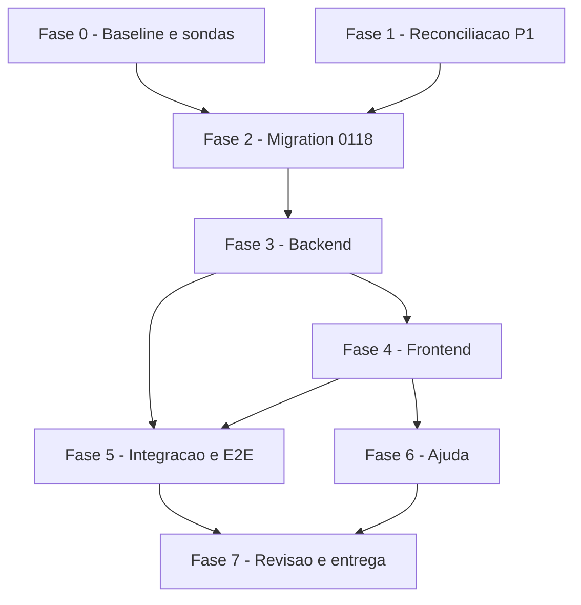

# Tarefas envioMassa_homologacao - repasse-gera-movimento

Escopo: gerar o Envio em Massa a partir do repasse (fecha a apuração se não existir, abate o pago por fora só da nota, recusa por adiantamento pendente nomeando quem trava, botão único em três telas), com a correção de S1 (id pré-alocado, reserva com o id, conclusão com o MESMO id), S7 (tenant) e S5 (ACL). Fonte: `spec.md` + `plan.md` (F0–F7) + `data-model.md` + `contracts/` + `quickstart.md` (C1–C15). Mecanismo de S1: **terceiro desenho** (`dec-038`, autorizado em `block-002` → `dec-040`) — o único descrito.

**Legenda de status:**
- `[ ]` Pendente
- `[~]` Em andamento
- `[x]` Concluido
- `[!]` Bloqueado

**Legenda de criticidade:**
- `[C]` Critico - Impacto financeiro direto ou bloqueante
- `[A]` Alto - Funcionalidade essencial
- `[M]` Medio - Necessario mas sem urgencia imediata

**Prefixos de path:** `BK` = `app_homologacao/backend` · `FE` = `app_homologacao/frontend_v2` · `MIG` = `infra/hub/migrations` · `DRV` = `infra/hub/testes`.

## Regras de execução (valem para TODAS as tarefas)

1. **Produção é intocável.** "Homologação" É produção: nunca `docker service update`, nunca escrita em `chatmasterveloz`, nunca stacks do Swarm. A `0118` é **artefato**; aplicá-la em produção é ato do operador. Testes rodam no isolado `hub-homolog`/`hub-test-*` (exceção escopada `hub-*`), após `preflight.sh`.
2. **Não commita, nunca `git add`, nunca `git stash`.** Cada etapa do ciclo git (commit, PR, merge, build, deploy) é autorização separada do operador.
3. **`0118` ANTES do código que a consome.** Nenhuma tarefa da FASE 3 começa antes de a `0118` estar aplicada e verde no isolado (2.8). Nenhuma tarefa de FE que dependa do 409 novo antes da FASE 3 correspondente.
4. **S5 é item de aceite, não opcional:** `REVOKE ALL ... FROM PUBLIC` + `GRANT EXECUTE ... TO authenticated` após **cada** `DROP FUNCTION`/`CREATE` da `0118` (2.5). Sem o teste de ACL verde, a FASE 2 não fecha.
5. **Controle negativo por correção, com reversão conferida.** Para cada correção: (a) reverter a correção, (b) **conferir no arquivo** que a reversão aconteceu (`git diff`/`grep` do trecho), (c) medir — **tem de falhar**, e conferir **QUAIS** testes falham (não só que algum falha), (d) restaurar, (e) conferir no arquivo que voltou, (f) medir verde. Teste que passa nas duas rodadas é oco. A tabela de testes (§P2, ao final) fixa a expectativa das duas rodadas.
6. **Preferir restringir a generalizar.** Na dúvida, recusar com motivo nomeado; nunca arbitrar valor, rateio, texto ou escopo. Nenhum fallback silencioso.
7. **Não abrir bloqueio humano por desenho.** O que o plano não cobrir: critério mais conservador, registrar Decisão, seguir. S2 segue **deferido** (`dec-026`) — não reabrir; `POST /repasse/:periodo/fechar` **não é tocado**.
8. **Dados factuais só com fonte** (Constitution/contrato do agente): nomes de campos, rotas e valores vêm do código, do `plan.md` ou de chamada observada.
9. **`package-lock.json` sem diff** ao fim de qualquer tarefa que rode o E2E (o container do Playwright o reescreve): conferir e reverter.
10. **Gates (baseline 2026-10-28):** backend `npm test` **2136/0** · `test:hub:unit` **1426/0** · `tsc --noEmit` frontend_v2 **e** motorista limpo · vitest frontend_v2 **981/0** (+ novos) · motorista **126/0** (`node --test`) · lint **28 (5/23)** (erro novo bloqueia) · `hub-adiantamentos-integration` **231/0** · `hub-lancamento-externo-integration` **150/0** · `hub-repasse-lote-integration` **86/0** · roundtrip **57/0** · rollback **37 PASS**. Relatar **com números**.

---

## FASE 0 - Baseline medida e sondas de viabilidade

### 0.1 Baseline dos gates e do ambiente `[A]`

Ref: plan.md F0; P7

- [x] 0.1.1 `git status` lido arquivo a arquivo; anotar `sha256` do `package-lock.json` de `FE` e de `frontend_motorista`
- [x] 0.1.2 `df -h /` (abortar o build se < ~20 GB livres) e swap ativa; anotar os números
- [x] 0.1.3 Rodar e anotar todos os gates da regra 10 (números reais, não os de memória)
- [x] 0.1.4 Registrar a baseline em `docs/specs/repasse-gera-movimento/evidencias.md` (arquivo único de evidência, alimentado por P7)
- [x] 0.1.5 Teste: a baseline reproduzida duas vezes dá os mesmos números; divergência é investigada antes de seguir

### 0.2 Sondas de viabilidade do mecanismo de S1 no `hub-homolog` `[C]`

Ref: plan.md §S1; `MIG/0033:197`, `MIG/0092:44`, `MIG/0092:63`

- [x] 0.2.1 Sondar, com o papel `authenticated`, que `SELECT nextval('"EnvioMassa_id_seq"')` funciona sem privilégio novo (`0033:197`)
- [x] 0.2.2 Sondar que `POST EnvioMassa` via PostgREST aceita `id` explícito (coluna `bigserial`) e que a sequência não é afetada
- [x] 0.2.3 Sondar o formato do erro que `hubPostgrestRequest` devolve para violação de `UNIQUE` da trilha e de PK da `EnvioMassa` (status e código `23505`), para o `catch` distingui-las de falha comum
- [x] 0.2.4 Varrer `routes/` e `lib/` por `DELETE` em `EnvioMassa` (medido 2026-10-28: nenhum) e registrar; se existir, anotar o caminho e tratar na tarefa 3.8
- [x] 0.2.5 Teste: cada sonda deixa o comando e a saída literal em `evidencias.md`; sonda sem saída literal não vale

---

## FASE 1 - Reconciliação dos artefatos (P1)

> Concluída na onda-007: os artefatos agora descrevem **um** mecanismo. Mantida no backlog como registro auditável e porque a tarefa 7.1 reconfere.

### 1.1 Um único mecanismo de S1 em todos os artefatos `[C]`

Ref: `dec-038`, `dec-040`; plan.md §S1

- [x] 1.1.1 `plan.md` §S1 reescrita: id pré-alocado + reserva com o id + conclusão com o mesmo id; banner de "conflito aberto" e descrição de `dec-034` removidos
- [x] 1.1.2 `data-model.md` §`ApuracaoRepasseMovimento`, `contracts/hub-repasse-gerar-movimentos.md` §Idempotência, `quickstart.md` C3/C10/C10b/C10c e `deferred-work.md` alinhados
- [x] 1.1.3 U2 (dinheiro): o `PATCH` e a promessa "retry completa" apagados do contrato; fluxo correto como única ordem
- [x] 1.1.4 Teste: `grep` por `PATCH`/`reservar_movimento`/`liberar`/`5 min` nos artefatos só acha menções históricas marcadas como descartadas

### 1.2 Correções da auditoria de veracidade `[C]`

Ref: plan.md §Correções da auditoria

- [x] 1.2.1 U1: árvore do plan aponta os drivers `DRV/hub-adiantamentos-integration.sh` e `DRV/hub-lancamento-externo-integration.sh`
- [x] 1.2.2 U3 (muda dinheiro): rótulo "fail-closed" retirado; a guarda migra como **informado, não bloqueado**
- [x] 1.2.3 U4: "(ids 1–8)" removido; fica "8 empresas"
- [x] 1.2.4 Teste: `grep -n "ids 1" docs/specs/repasse-gera-movimento/*.md` vazio; `grep -n "fail-closed"` só em registro histórico de correção

### 1.3 Derivas de âncora propagadas `[A]`

Ref: plan.md §Correções da auditoria

- [x] 1.3.1 D6: imutabilidade em `MIG/0066:460`–`:461` + `:463` + `:470`–`:478` em todos os artefatos
- [x] 1.3.2 D1: predicado da CTE em `MIG/0117:866`–`:867`
- [x] 1.3.3 Demais derivas: `0117:759-771`, `0117:818-827`, `0098:50`, `:2306`, laço `:2309-2323`
- [x] 1.3.4 Teste: `grep` das âncoras antigas só acha a tabela de derivas do plan

### 1.4 Inconsistências internas e emenda de UI `[A]`

Ref: plan.md §3 D8; contracts/ui-gerar-do-repasse.md

- [x] 1.4.1 Teste de duas semanas aponta para o **driver** (a versão `.test.js` usa RPC mockada)
- [x] 1.4.2 D8 refeito: `action-bar.tsx` é compartilhado ⇒ três telas, duas montagens; botão usa seletor ISO próprio; default na semana anterior à corrente (P8)
- [x] 1.4.3 Teste: `contracts/ui-gerar-do-repasse.md` e `plan.md` §3 dizem a mesma coisa sobre montagens e default

---

## FASE 2 - Migration `0118` (artefato; antes de todo código que a consome)

### 2.1 Coluna `nota_a_emitir` `[C]`

Ref: plan.md F1; data-model.md; `MIG/0098:50`

- [x] 2.1.1 Criar `MIG/0118_repasse_nota_a_emitir.sql` com `ALTER TABLE "ApuracaoRepasseItem" ADD COLUMN IF NOT EXISTS nota_a_emitir numeric(12,2)` + `COMMENT ON COLUMN`
- [x] 2.1.2 Não editar a `0117` nem a `0098`; não alterar o CHECK `apuracaorepasseitem_saldo_conserva`
- [x] 2.1.3 Teste: a coluna existe após aplicar no isolado, é `NULL` nas linhas antigas e os bloqueios de imutabilidade (`0066:460`–`:461`, `:463`, `:470`–`:478`) seguem intactos

### 2.2 `hub_adiantamento_repasse_fechar`: dedução na nota, excedente em `transportado_nota`, predicado da CTE `[C]`

Ref: plan.md F1.2 (a–d), §1, §2.bis; `MIG/0117:708`, `:866`–`:867`, `:909`–`:910`

- [x] 2.2.1 Partir do corpo **vivo** (`0117:708`) byte a byte; só as mudanças a–d
- [x] 2.2.2 (a) `deducao_aplicada_na_nota = LEAST(externos_deducao, GREATEST(total_nota + saldo_anterior_nota, 0))`; `nota_a_emitir = total_nota + saldo_anterior_nota − deducao_aplicada_na_nota` (piso 0)
- [x] 2.2.3 (c) excedente (`externos_deducao − deducao_aplicada_na_nota`) em `transportado_nota` **negativo**; nada vai ao caixa (o CHECK proíbe)
- [x] 2.2.4 (d) predicado da CTE `linhas` ganha `OR COALESCE(sa.transportado_nota, 0) <> 0` (senão o motorista de N+1 sem produção some e a dívida se perde)
- [x] 2.2.5 (b) `valor_nota`, `valor_fora_nota` e `nota_a_emitir` gravados com `CASE WHEN v_config.categorias_nota IS NULL THEN NULL ELSE COALESCE(..., 0) END` (a prévia já usa; o fechamento hoje grava `NULL` cru em `0117:909`–`:910`)
- [x] 2.2.6 Sem `categorias_nota`: `nota_a_emitir = NULL` (não `0`, que colide com `VALOR_ZERO`) e **nenhum** transporte no livro da nota
- [x] 2.2.7 Tipo de retorno não muda ⇒ `CREATE OR REPLACE` preserva os `GRANT`; repetir o par `REVOKE`/`GRANT` por idempotência
- [x] 2.2.8 Teste: cenários C4/C5 (§P2: T01–T06) no driver, **duas rodadas** conforme a tabela, com reversão conferida no arquivo

### 2.3 Prévia e congelado devolvem o mesmo líquido `[C]`

Ref: plan.md F1.3; `MIG/0117:690`–`:707`, `:942`, `:1253`, `:1035`–`:1037`

- [x] 2.3.1 `DROP FUNCTION` + `CREATE FUNCTION` de `hub_adiantamento_repasse(date, text, boolean, int, int)` com a nova coluna (SC-002: a tela mostra o que a geração usará)
- [x] 2.3.2 Idem para `hub_adiantamento_repasse_congelado(date, text, boolean, int, int)`
- [x] 2.3.3 **Cada `CREATE` seguido do seu `GRANT EXECUTE`** (armadilha documentada em `0117:690`–`:707`)
- [x] 2.3.4 Não tocar as duas funções do app do motorista nem `hub_adiantamento_repasse_pode_fechar`
- [x] 2.3.5 Teste: prévia e congelado devolvem o mesmo `nota_a_emitir` que o fechamento gravou, para a mesma semana (SC-002); app do motorista inalterado (C15)

### 2.4 `hub_repasse_alocar_envio_id()` (peça nova de S1) `[C]`

Ref: plan.md §S1; `MIG/0033:197`; `dec-038`

- [x] 2.4.1 `CREATE OR REPLACE FUNCTION hub_repasse_alocar_envio_id() RETURNS bigint LANGUAGE sql SECURITY INVOKER AS $$ SELECT nextval('"EnvioMassa_id_seq"') $$` (forma exata validada pela sonda 0.2.1)
- [x] 2.4.2 **Zero** `SECURITY DEFINER` novo, **zero** `ALTER`/`GRANT`/policy na trilha, **zero** `DELETE`
- [x] 2.4.3 Teste: chamada como `authenticated` devolve ids estritamente crescentes; como `anon` é recusada

### 2.5 S5 — ACL de toda função criada/recriada (item de aceite) `[C]`

Ref: plan.md §S5; `MIG/0067:2278`–`:2279`

- [x] 2.5.1 `REVOKE ALL ON FUNCTION ... FROM PUBLIC;` + `GRANT EXECUTE ON FUNCTION ... TO authenticated;` para prévia, congelado e `hub_repasse_alocar_envio_id`; repetir em `hub_adiantamento_repasse_fechar`
- [x] 2.5.2 `SET search_path = public, pg_temp` preservado (não mexer)
- [x] 2.5.3 Teste de ACL: `has_function_privilege('anon', '<assinatura>', 'EXECUTE') = false` para as três, `proacl` conferido antes/depois (⚠️ `PUBLIC` aparece como `=X/`, sem papel antes do `=`); rodada 1 com a migration **sem** os `REVOKE` tem de acusar `true`

### 2.6 Idempotência da `0118` provada (P3) `[C]`

Ref: P3; `MIG/0117:10`–`:11`

- [x] 2.6.1 Aplicar a `0118` **duas vezes** seguidas no isolado pelo `infra/hub/scripts/migrate.sh` (nunca à mão: `SchemaMigration` mente fora do script); a segunda não falha nem altera estado
- [x] 2.6.2 Nada `CONCURRENTLY` (o `migrate.sh` roda em uma transação)
- [x] 2.6.3 `SIGUSR1` no PostgREST do **hub** após aplicar (sonda em `/rpc/` não prova reload); anotar
- [x] 2.6.4 Teste: rodada 1 com uma variante sem `IF NOT EXISTS` falha na 2ª aplicação; rodada 2 (a real) passa — prova que o teste detecta não-idempotência

### 2.7 Controle negativo da dedução na nota (M5) `[C]`

Ref: plan.md §Riscos; research.md M5

- [x] 2.7.1 Rodar o teste de nota líquida **sem** a `0118` aplicada: a nota tem de sair **bruta** (a dedução hoje só entra no `remanescente`)
- [x] 2.7.2 Aplicar a `0118` e repetir: a nota sai líquida e o excedente aparece em `transportado_nota`
- [x] 2.7.3 Teste: as duas rodadas anotadas em `evidencias.md` com os números

### 2.8 Gate de saída da FASE 2 `[C]`

Ref: plan.md F1 "Gate desta fase"

- [x] 2.8.1 `0118` aplica sem erro, é idempotente (2.6) e passa o teste de ACL (2.5)
- [x] 2.8.2 Rollback ensaiado: o driver de rollback (37 PASS) e o de perf seguem verdes
- [x] 2.8.3 Teste: `hub-lancamento-externo-integration` **150/0** e `hub-adiantamentos-integration` **231/0** sem regressão com a `0118` aplicada e o código antigo (a migration é aditiva e o código antigo segue funcionando)

---

## FASE 3 - Backend: pré-flight, tenant, S1, fechar-se-não-existir

> Pré-condição: 2.8 verde. Dentro da fase, a ordem é obrigatória: 3.1 → 3.2 → 3.3 → 3.4 → 3.5 → 3.6.

### 3.1 Helper compartilhado do mapeamento de erros do fechamento `[A]`

Ref: plan.md F2.1; `BK/routes/hub-adiantamentos.js:2110`–`:2135`

- [x] 3.1.1 Suíte verde **antes** de mexer (rede de não-regressão)
- [x] 3.1.2 Extrair o mapeamento de `POST /repasse/:periodo/fechar` para helper compartilhado; `/fechar` passa a usá-lo **sem mudar comportamento** (rota intocada em contrato — S2 deferido)
- [x] 3.1.3 Suíte verde **depois**, mesmos números
- [x] 3.1.4 Teste: `hub-adiantamentos-rotas-unit.test.js` (que já mocka o RPC de fechar, `:357`) cobre os 7 códigos pelo helper

### 3.2 Pré-flight de pendências de adiantamento (sempre; antes de remover o 409) `[C]`

Ref: plan.md §4, F2.2; contracts/hub-repasse-gerar-movimentos.md; FR-008/FR-009

- [x] 3.2.1 Antes de fechar/gerar, consultar `AdiantamentoSolicitacao?id_empresa=in.(<escopo do token>)` com os 6 status do RPC (`0117:759`–`:771`) — **sempre**, também quando a apuração já existe
- [x] 3.2.2 `409 ADIANTAMENTOS_PENDENTES` com `{ total, porStatus, motoristas[], motoristasOmitidos }`, lista capada em **20**, **sem CNPJ, telefone, conta ou valor**
- [x] 3.2.3 Nada fechado e nada criado na recusa; log só com contagens
- [x] 3.2.4 Teste: C9/9b/9c (§P2: T10, T11) — inclui varredura das chaves do JSON provando ausência de PII; rodada 1 (código antigo) tem de falhar

### 3.3 `planejarGeracao` lê `nota_a_emitir` (P4) `[C]`

Ref: plan.md F2.3; P4; `BK/lib/adiantamento-geracao-movimento.js:114`, `:137`–`:164`

- [x] 3.3.1 `valor` = `item.nota_a_emitir`; gorjeta **inalterada**; **sem** ramo de fallback para `valor_nota`
- [x] 3.3.2 **P4**: `nota_a_emitir IS NULL` **com** `valor_nota` não nulo (categorias configuradas) ⇒ **recusa fail-closed** com motivo próprio (`MOTIVOS` ganha uma entrada nomeada, ex. nota líquida ausente), **jamais** cair no `valor_nota` bruto
- [x] 3.3.3 `nota_a_emitir IS NULL` com `valor_nota IS NULL` segue como `SEM_DIVISAO` (inalterado); `VALOR_ZERO` preservado
- [x] 3.3.4 Teste: `adiantamento-geracao-movimento-unit.test.js` (T07, T05, T06 do §P2); rodada 1 (planejarGeracao lendo `valor_nota`) tem de gerar com valor bruto e falhar

### 3.4 S7 — filtro de tenant na consulta de movimento aberto `[C]`

Ref: plan.md §S7; `BK/routes/hub-adiantamentos.js:2250`–`:2251`, `:2278`, `:2282`; `BK/lib/hub-postgrest-lotes.js:39`

- [x] 3.4.1 Rodar **antes** o cenário C11b e ver **falhar** (movimento aberto de outra empresa recusando `MOVIMENTO_ABERTO`)
- [x] 3.4.2 `id_empresa=in.(<ids do grupo>)` na consulta de "abertos", ids resolvidos **uma vez** por `mesmoGrupoQue(GRUPO_MOVEE_ID, GRUPO_MOVEE_ID, cache)` e reusados pela consulta de histórico (nunca `id_empresa === 6` estrito)
- [x] 3.4.3 Reverter a correção, **conferir no arquivo**, medir (tem de falhar), restaurar, conferir, medir verde
- [x] 3.4.4 Teste: T18 (§P2) no driver

### 3.5 S1 — laço de geração: alocar id → reserva com o id → `EnvioMassa` com o mesmo id `[C]`

Ref: plan.md §S1; `dec-038`; `BK/routes/hub-adiantamentos.js:2306`–`:2323`; `BK/lib/adiantamento-geracao-movimento.js:15`, `:177`–`:191`

- [x] 3.5.1 Pré-filtro (uma vez, antes do laço): ler a trilha da apuração e `EnvioMassa?id=in.(<ids da trilha>)&id_empresa=in.(<grupo>)&select=id` em lotes; separar `jaGerados` (trilha com `EnvioMassa`) de `reservados` (trilha sem `EnvioMassa`)
- [x] 3.5.2 Motorista fora de `reservados`: `rpc/hub_repasse_alocar_envio_id` → `POST ApuracaoRepasseMovimento` **com** o `envio_massa_id`; violação do `UNIQUE (apuracao_id, entregador_id)` ⇒ `JA_GERADO` (nada escrito em `EnvioMassa`)
- [x] 3.5.3 Motorista em `reservados`: reusar o id reservado; valor/gorjeta da trilha **têm de bater** com os recomputados — divergência ⇒ `FALHA_AO_GRAVAR` nomeando a divergência, **não** conclui
- [x] 3.5.4 `POST EnvioMassa` com `{...alvo.linha, id}` (spread no ponto do `POST`; `planejarGeracao` continua pura, sem campo `id`); violação de PK ⇒ `JA_GERADO`
- [x] 3.5.5 O `POST ApuracaoRepasseMovimento` posterior ao `EnvioMassa` (`:2313`) **sai** do laço; **nenhum** `PATCH`, **nenhum** `DELETE`, **nenhuma** heurística de tempo
- [x] 3.5.6 `catch` com o texto verdadeiro por falha (tabela de plan.md §S1): "nada foi gravado" só quando é verdade; "reserva registrada, movimento não criado, tentar de novo é seguro" quando a reserva existe sem `EnvioMassa`
- [x] 3.5.7 Teste: T14–T17 (§P2) no driver — duplicata sem a correção (rodada 1), zero duplicata com ela; controle negativo "concluir com id novo duplica"; duas conclusões concorrentes ⇒ exatamente uma linha; texto literal sem "nada foi gravado para este motorista" quando a reserva existe

### 3.6 Fechar-se-não-existir e remoção do 409 `[C]`

Ref: plan.md F3; contracts/hub-repasse-gerar-movimentos.md §Ordem de operações; `BK/routes/hub-adiantamentos.js:2193`

- [x] 3.6.1 Remover `409 APURACAO_NAO_FECHADA` (`:2193`) **somente depois** de 3.2 e 3.5 estarem no ar no isolado
- [x] 3.6.2 Apuração inexistente ⇒ `rpc/hub_adiantamento_repasse_fechar`; erros pelo helper de 3.1 com o texto de cada um (`PERIODO_EM_ABERTO` diz **até quando** esperar)
- [x] 3.6.3 `APURACAO_JA_FECHADA` deixa de ser erro nesta rota: relê a apuração e segue para a geração
- [x] 3.6.4 `PERIODO_EM_ABERTO`, `APURACAO_FORA_DE_ORDEM`, `APURACAO_NAO_CONFIGURADA`, `PERIODO_DESALINHADO`, `EMPRESA_SEM_CNPJ` continuam recusando
- [x] 3.6.5 Modelo de mensagem ausente ⇒ recusa com aviso, nunca texto inventado (D10/FR-012)
- [x] 3.6.6 Teste: C1, C2, C3, C6, C8 (§P2: T12, T13, T20, T21); rodada 1 devolve `APURACAO_NAO_FECHADA`

### 3.7 Auditoria das duas ações `[M]`

Ref: plan.md F3.4

- [x] 3.7.1 Registrar `adiantamento.repasse_fechado` (quando a rota fechou) **e** `adiantamento.movimentos_gerados`
- [x] 3.7.2 Teste: fechamento implícito aparece na trilha de auditoria; sem fechamento, só a segunda ação

### 3.8 P6 — varredura de TODA chamada a `EnvioMassa` e tenant `[C]`

Ref: P6; plan.md §Riscos; BRIEFING §7 (a tabela não tem RLS)

- [x] 3.8.1 Listar toda leitura/escrita de `EnvioMassa` tocada ou criada por esta frente (abertos, histórico, existência por `id`, `POST` com `id`) e confirmar o filtro `id_empresa=in.(<grupo>)` em **cada** uma; anotar a lista em `evidencias.md`
- [x] 3.8.2 Reconferir a ausência de `DELETE` em `EnvioMassa` (sonda 0.2.4) e registrar o limite "apagar uma `EnvioMassa` já gerada faz a próxima geração recriá-la"
- [x] 3.8.3 Teste: JWT assinado **de outra empresa** (com a permissão) não lê nem conclui movimento da Movee; rodada 1 sem o filtro vaza (T19)

---

## FASE 4 - Frontend: componente único, guarda migrada, três telas

### 4.1 P5 — abrir as telas onde o dado já aparece, antes de qualquer rótulo `[A]`

Ref: P5; CLAUDE.md §"Propor UI nova"

- [x] 4.1.1 Abrir a tela de Repasse, a tela de Envio em Massa legada, a do hub e a home do app motorista; anotar **onde** cada informação nova (contagem por status, nomes que travam, nota líquida, motivos de recusa) já aparece hoje
- [x] 4.1.2 Reusar o vocabulário vigente (`resumirRecusas`, "Gerar notas da semana", "Pago por fora"); o rótulo "Gerar do repasse" é o de FR-014 (decisão do operador) — nenhum rótulo adicional sem a frase de onde o dado aparece hoje
- [x] 4.1.3 Registrar a frase "isto já aparece em X" por proposta de UI em `evidencias.md`
- [x] 4.1.4 Teste: nenhuma tarefa 4.2–4.5 começa sem 4.1.3 preenchido; revisão adversarial (7.2) confere

### 4.2 P9 — migrar a guarda e os 5 testes ANTES de remover o diálogo `[C]`

Ref: P9; `FE/components/hub/adiantamento-fechar-apuracao-dialog.tsx:54`–`:56`, `:93`–`:135`; `repasse/page.test.tsx:193`–`:250`

- [x] 4.2.1 Mover para o componente novo a confirmação de remanescente negativo **preservando "informado, não bloqueado"**: caixa exigida quando `qtdNegativo > 0` **ou** quando o resumo é desconhecido (carregando, erro, campo ausente); **nunca recusa** — marcada a caixa, o fechamento segue
- [x] 4.2.2 Mover o `AvisoLancamentoExterno` junto
- [x] 4.2.3 Migrar os **5 testes** (`A2` e os 4 de `C4`) **sem alterar as asserções**
- [x] 4.2.4 Controle negativo: componente sem a guarda ⇒ os 5 migrados **falham** (conferir QUAIS)
- [x] 4.2.5 Só então liberar a remoção do diálogo (4.5)
- [x] 4.2.6 Teste: T23 (§P2); migrar como bloqueio (fail-closed) quebraria o teste "A2: NÃO é recusado"

### 4.3 Componente único `GerarDoRepasseButton` (P8) `[C]`

Ref: P8; contracts/ui-gerar-do-repasse.md; plan.md §3

- [x] 4.3.1 `FE/components/hub/gerar-do-repasse-button.tsx`: renderiza **nada** sem `adiantamentos.pagamento_confirmar`; uma prop `periodo?: string`, sem `variant`
- [x] 4.3.2 Com `periodo` ⇒ sem seletor; sem `periodo` ⇒ `<input type="date">` com valor **sempre ISO** `YYYY-MM-DD` e **default = semana imediatamente anterior à corrente** (a corrente sempre recusa `PERIODO_EM_ABERTO`, `MIG/0067:1899`); recusa pelo corte D-1 continua explicada
- [x] 4.3.3 Uma função de client (`gerarMovimentos`), uma rota; toast de sucesso/recusa com `resumirRecusas`
- [x] 4.3.4 Texto próprio para cada um dos 6 códigos de 409 do fechamento; nenhuma "recusa misteriosa"
- [x] 4.3.5 Teste: `gerar-do-repasse-button.test.tsx` (T22, T24): sem permissão nada renderiza; default da semana anterior; ISO; `gerarMovimentos` chamada **uma** vez por acionamento; rodada 1 (componente inexistente) falha

### 4.4 Diálogo de recusa por pendências `[A]`

Ref: plan.md F4.3; FR-009; contracts

- [x] 4.4.1 Renderizar contagem por status, nomes (cap 20) e `motoristasOmitidos` em diálogo, não em toast, reusando a exibição de `pendencias` do diálogo aposentado (deleção líquida)
- [x] 4.4.2 Nomes como **texto**, sem HTML; nenhum CNPJ/telefone/valor no DOM
- [x] 4.4.3 Tipo `AdiantamentosPendentes` em `FE/lib/hub/adiantamentos-api.ts`
- [x] 4.4.4 Teste: o corpo renderizado não contém CNPJ/telefone/valor; `adiantamentos-api.test.ts` cobre o novo tipo e `gerarMovimentos` (hoje sem cobertura, M14)

### 4.5 Tela de Repasse: entra o componente, saem o botão e o diálogo de fechar `[C]`

Ref: plan.md F4.2; FR-013; `FE/app/hub/dashboard/adiantamentos/repasse/page.tsx`

- [x] 4.5.1 Pré-condição: 4.2 concluída (guarda e testes migrados)
- [x] 4.5.2 Substituir o botão inline de gerar (`~:245`–`:259`) por `<GerarDoRepasseButton periodo={h.periodo} onSucesso={h.refetch} />`, habilitado com semana "aberta" (`situacao` ≠ corte)
- [x] 4.5.3 Remover "Fechar apuração" e `<FecharApuracaoDialog>`/`useFecharApuracaoDialog`; **manter** `fecharRepasse()` no client e a rota `/fechar` (FR-013 literal)
- [x] 4.5.4 Teste: `repasse/page.test.tsx` — "Fechar apuração" não existe e "Gerar" está habilitado; **tem de falhar antes da mudança** (T22b); `tsc` e vitest verdes

### 4.6 `action-bar.tsx` e `HubAuthProvider` no painel legado `[A]`

Ref: plan.md §3; contracts/ui-gerar-do-repasse.md §Montagem 2

- [x] 4.6.1 Montar `<GerarDoRepasseButton />` ao lado do `<ImportButton>` (`:109`) **sem** repassar a `periodo` textual (`DD/MM/AAAA a DD/MM/AAAA`) da tela do hub; vale para as duas telas de Envio em Massa (legada e hub)
- [x] 4.6.2 `FE/app/dashboard/layout.tsx`: `HubAuthProvider` **sem** `HubSessionGuard` (o redirect vive no guard; sem sessão de hub o botão não renderiza e o login legado fica intacto)
- [x] 4.6.3 Não tocar `import-button.tsx` nem `app/dashboard/page.tsx`
- [x] 4.6.4 Teste: sessão só-legado ⇒ botão ausente, nenhum redirect, nenhum `Set-Cookie`; sessão de hub com a permissão ⇒ botão presente nas duas telas de Envio em Massa (C13)

### 4.7 Impeccable e acessibilidade `[A]`

Ref: gates; CLAUDE.md §Rito do ciclo git etapa 1

- [x] 4.7.1 Detector impeccable sobre o componente novo e o diálogo: **0 achados**
  - _onda-013 (medido)_: o diálogo **não é** arquivo separado — vive dentro de `gerar-do-repasse-button.tsx` (`:145` `<AlertDialog>`; o comentário em `:7` registra que a guarda do antigo `FecharApuracaoDialog` migrou para lá, e `adiantamento-fechar-apuracao-dialog.tsx` foi deletado). O detector, cobrindo esse arquivo com 0 achados, cobriu **componente + diálogo**. Estava `[~]` por leitura equivocada de escopo, não por falta de medição.
- [x] 4.7.2 Medir no DOM área tocável e tema escuro (`<option>` no tema escuro é gotcha conhecido)
  - _onda-013_: parte **estática** medida (`evidencias.md:179` — `min-h-11 sm:min-h-8`, `h-11` no campo de data). **Gatilho**: disco `/` ≥ 21 GB (host em 20 GB então).
  - ✅ _onda-017 — **MEDIDA NO DOM VIVO**_ (`dec-089`). Disco liberou (**22.104.496 KB** contra os 21.943.040 da guarda), driver rodou, **16/16 passed**. Teste novo em `adiantamentos.spec.ts:792` (`4.7.2: área tocável …`), viewport mobile **fixado em 390×844** — o config do driver é `Desktop Chrome`, onde o ramo `sm:min-h-8` (32px) vale **de propósito** e asseverar 44 reprovaria por desenho. Controle negativo nomeado no próprio teste: sem o `setViewportSize` ele mede o ramo `sm:` e falha em ~32px, logo não passa por acidente.
  - 📏 **Medido**: gatilho e campo de data **≥ 44px** ✅. **Ações do rodapé do diálogo: 31,32px** ❌ — abaixo da barra. Determinístico (falhou nas 3 tentativas, retries idênticos).
  - ⚠️ **E a medição no DOM pegou o que a leitura do código não viu**: `evidencias.md:179` declarava a área tocável OK com base na classe do componente — e o rodapé do diálogo não tem classe nenhuma. É literalmente o gotcha do projeto ("medir no código não substitui medir no DOM"), confirmado na prática.
  - **Não é regressão desta frente nem deste componente**: `size: default` do `Button` é `h-8` (32px) em **todos** os breakpoints (`components/ui/button.tsx:24`) e **nenhum** diálogo de `components/hub/` sobrescreve isso nas ações (**zero** ocorrências de `min-h-11` em `AlertDialogAction`/`AlertDialogCancel`, contra **37** usos do padrão `min-h-11 sm:min-h-8` no resto do hub). Causa-raiz **compartilhada**: `components/ui/alert-dialog.tsx` — uma correção lá cobriria todos os chamadores dos dois apps. **Dívida repo-wide registrada; corrigir é decisão do operador** (ver `deferred-work.md` §Onda-017).
  - O teste asserta **piso** (não pode encolher), não a barra de 44: pega regressão hoje e continua passando quando a dívida for paga.
- [x] 4.7.3 Teste: relatório do detector anexado em `evidencias.md` com a contagem
  - _onda-013_: `evidencias.md:179` é o relatório, com a contagem (**0 achados**) e a área tocável medida. Requisito cumprido.

---

## FASE 5 - Testes de integração e cenário de ponta a ponta (no `hub_homolog`)

### 5.1 Fixtures obrigatórias `[A]`

Ref: quickstart.md FX-1..FX-4; plan.md F5

- [x] 5.1.1 FX-1: `mensagem1_modelo` **configurado** (hoje é `NULL` no `hub_homolog`; sem ele o caminho feliz passa pelo ramo de recusa D10 sem exercitar nada)
- [x] 5.1.2 FX-2 `categorias_nota` configurado; FX-3 JWT **com** claim de escopo (sem ela a prévia devolve zero e parece defeito); FX-4 semana com produção encerrada e corte passado
- [x] 5.1.3 Teste: um teste prova que **sem** modelo a recusa acontece (C8)

### 5.2 Driver de adiantamentos: C1–C3, C6–C12 `[C]`

Ref: quickstart.md; `DRV/hub-adiantamentos-integration.sh`

- [~] 5.2.1 Implementar os cenários C1, C2, C3, C6, C7, C8, C9/9b/9c, C10, C10b, C10c, C11/11b, C12 conforme a tabela §P2
  - _Rastreio por nome (FASE 8, medido)_: **C10b** = `tests/hub-repasse-movimentos-rota-unit.test.js:242` ("T13/T15 falha do POST EnvioMassa: texto VERDADEIRO (reserva existe) e a retomada conclui com o MESMO id, sem duplicar"), `:265` ("falha ao ALOCAR/reservar: 'nada foi gravado' e verdade") e `:296` ("reserva com valor/gorjeta DIFERENTES dos recomputados: nao conclui, nomeia a divergencia") — os três estados de CHK005. **C10c** = `:283` ("T17 duas CONCLUSOES concorrentes da mesma reserva: exatamente uma linha (a PK serializa)") + `infra/hub/testes/hub-adiantamentos-integration.sh:2674`/`:2675` (sobreposição real >= 1000 ms) e o controle negativo `:2677`. **C11b** = `:306` ("T18 S7: movimento aberto de OUTRA empresa nao conta; o do grupo conta") + `infra/hub/testes/hub-repasse-saldo-minimo-roundtrip-integration.sh:520`. **C9c** = ~~sem check nomeado~~ → **`T11b C9c resolvidos os pendentes, passa`** (mesmo arquivo, `:180`; FASE 8): recusa `409` sem resíduo, depois o MESMO pedido vira `201` com exatamente um movimento. Controle negativo medido: sem resolver os pendentes o teste falha. O que **não** é provado por ele: a transição contra banco real (o fake não tem o advisory lock nem o `UNIQUE`).
  - ⚠️ _onda-017 — **o gatilho registrado aqui estava ERRADO**_ (`dec-090`). Dizia que o bloqueio era "o desbloqueio do disco (>= 21 GB) que libera o stack `hub-test-*`". **O disco liberou** (22.104.496 KB, acima da guarda) **e o cenário continua inalcançável, por outro motivo**: `hub-adiantamentos-integration.sh` **não faz nenhuma chamada de rede ao backend** (contagem zero) — é SQL puro via `psql` com `set_config` de `request.jwt.claims`, e o bloco S1 (`:2621`-`:2685`) modela o laço em **plpgsql**, nunca pela rota. **C9c é cenário de ROTA.** Os drivers vizinhos de repasse também não dirigem essa rota (smoke-full-chain zero, roundtrip zero, nota-líquida zero).
  - **Custo real, nomeado**: levar C9c ao banco real exige **dar capacidade de rota ao driver** (JWT real + chamada HTTP ao backend + limpeza do estado de apuração), não disco. Não feito nesta onda: o operador autorizou *rodar* o que estava travado por disco, não criar harness novo num driver de dinheiro. Segue `[~]` com o custo correto no lugar do gatilho falso.
- [x] 5.2.2 Cada correção com a sequência da regra 5 (reverter, conferir no arquivo, medir falhando, restaurar, conferir, medir verde)
- [x] 5.2.3 Baseline **231/0** preservada + os novos
- [x] 5.2.4 Teste: relatório com `QUAIS` testes falharam em cada rodada 1, anexado em `evidencias.md`

### 5.3 Driver do lançamento externo: C4 e C5 (duas semanas) `[C]`

Ref: plan.md §1; `DRV/hub-lancamento-externo-integration.sh`

- [x] 5.3.1 C4: pago por fora < nota abate só a nota, gorjeta intacta; controle negativo (sem `0118`: nota bruta)
- [x] 5.3.2 C5: dedução > nota na semana N e **nenhuma produção** em N+1 ⇒ N+1 entra (predicado da CTE) e a nota sai **reduzida**; sem o transporte, sai **maior**
- [x] 5.3.3 Rodar T04 **antes** da `0118` e ver falhar; se passar nas duas rodadas o teste é oco
- [x] 5.3.4 Baseline **150/0** preservada
- [x] 5.3.5 Teste: os números (nota de N+1 com e sem transporte) ficam em `evidencias.md`

### 5.4 Roundtrip, UI e fluxo posterior `[A]`

Ref: quickstart.md C13–C15; SC-007/SC-008

- [x] 5.4.1 C14 roundtrip backend↔frontend (borda obrigatória): **57/0** preservado + o novo
- [x] 5.4.2 C13: as três telas usam o mesmo componente e produzem resultado idêntico para a mesma semana
- [x] 5.4.3 C15: **emissão, validação de XML e "Fechar movimento" inalterados** (D12) — ✅ conferido. **Disparo e entrada (`/upload` + correção) MUDARAM**, com autorização do operador em `block-004` — o que é exatamente o que **FR-020a** agora declara.
  - _onda-017_: a asserção foi **reescrita para ser verdadeira** e fechou. O que faltava não era medição, era a emenda de FR: `spec.md` ganhou **FR-020a** separando o que de fato ficou intocado (fechamento, emissão, validação de XML) do que mudou (disparo via `selecionarAlvoDisparo` em `server.js:1341`; entrada via `linhaSemNada` em `server.js:1963` e `lib/envio-massa-correcao.js:163`). A chave de "há nota a emitir" ficou **única** — `EnvioMassa.valor > 0`, a mesma do app (`VALOR_EMITIVEL`) e do lote (`lib/disparo-alvo.js:7`).
  - Antes: afirmava "todo o fluxo posterior ao movimento inalterado", e **metade disso era falso** desde que FR-022 criou o movimento só-gorjeta. A frase sobreviveu à decisão que a invalidou — mesma classe de alarme que a frente já pagou duas vezes.
- [x] 5.4.4 Teste: `hub-repasse-lote-integration` **86/0** e rollback **37 PASS** sem regressão

### 5.5 E2E do hub pelo driver `[A]`

Ref: CLAUDE.md §Comandos; plan.md §Gates

- [x] 5.5.1 Rodar o E2E do hub **somente** pelo driver `DRV/*.sh` (nunca browser no host); `failed` já é regressão
  - ✅ **RODADO em 29/10**, pelo driver `infra/hub/testes/hub-adiantamentos-e2e-browser.sh` (nunca browser no host), depois que o
    operador liberou disco (19 → 21 GiB, ganho real de 1.702 MB). Resultado: **15/15 em TRÊS rodadas consecutivas** (13,1s / 13,2s /
    13,4s) — estável, não flaky.
  - 🔴 **A primeira rodada deu 3 falhas, e NENHUMA era defeito de produção — eram 3 stubs do próprio spec violando o contrato que o
    TypeScript declara.** O `tsc` não pegava nenhuma: são objetos literais dentro de `json(200, …)` e um tipo inline no `state`.
    (a) stub do resumo sem `qtdNegativo`/`totalNegativo` ⇒ `negativoDesconhecido` virava true e o botão de confirmar ficava
        **disabled para sempre** (fail-closed por desenho, `gerar-do-repasse-button.tsx:99-100`). 115 tentativas de clique.
    (b) stub dos lançamentos sem `semanaFechada` — campo **obrigatório** em `LancamentoExternoItem` (`:68`, *"sem ele a tela
        chutaria um dos dois"*). Herdado do PR #299, que escreveu o teste e nunca o executou (disco).
    (c) locator ambíguo em strict mode, **duas vezes**: `/Adiantamento liberado.*2/` casava o `<li>` da contagem e o `<ul>` dos nomes;
        e `getByRole('listitem')` casava os dois `<li>`, porque os nomes TAMBÉM são `<li>`. Discriminador lido do componente: a
        contagem começa pelo rótulo (`{rótulo}: {n}`), o nome o traz no fim (`{nome} — {rótulo}`).
  - **Lição**: um stub que omite campo obrigatório do contrato é invisível ao `tsc` e só o E2E pega. O spec ficou 6 dias "tipado mas
    nunca executado" e isso escondeu 3 defeitos de teste.
- [x] 5.5.2 Conferir e **reverter** o `package-lock.json` reescrito pelo container do Playwright
  - ✅ Nada a reverter nas 4 rodadas de 29/10: o próprio driver confere no cleanup e reportou
    `package-lock.json intacto` em todas. `git status` sem o arquivo modificado.
- [x] 5.5.3 Teste: `git status` sem `package-lock.json` modificado; `sha256` igual ao de 0.1.1

---

## FASE 6 - Ajuda nas duas centrais (FR-021)

### 6.1 Editar os JSON versionados `[M]`

Ref: plan.md F6; centrais de ajuda

- [x] 6.1.1 `FE/lib/hub/ajuda-conteudo.json` (hub): novo fluxo "gerar do repasse", recusa por pendência, pago por fora que abate a nota e excedente que vira saldo
- [x] 6.1.2 `app_homologacao/frontend_motorista/lib/ajuda-conteudo.json` (app): descrever o que o motorista vê (nota bruta + linha de pago por fora separada — dívida nomeada: vocabulário diverge do hub, ver `research.md`); **abrir a tela do app antes** (P5)
- [x] 6.1.3 Nunca editar o HTML publicado: os HTMLs são gerados dos JSON
- [x] 6.1.4 Teste: os dois `ajuda.test.ts` verdes (quebram se o JSON ganhar bloco que a tela não renderiza); motorista com `node --test` **126/0**

---

## FASE 7 - Revisão adversarial, evidência de não-regressão e preparo de entrega

### 7.1 Reconferência da reconciliação (P1) `[A]`

Ref: P1; tarefas 1.x

- [x] 7.1.1 Reler `plan.md`, `data-model.md`, `contracts/`, `quickstart.md` e esta lista contra o código final: um único mecanismo de S1, âncoras `path:linha` ainda corretas
- [x] 7.1.2 Atualizar as âncoras que o código novo moveu; nada de contradição entre artefatos
- [x] 7.1.3 Teste: `grep` por `PATCH`, `reservar_movimento`, `liberar`, `5 min` não acha menção viva

### 7.2 Revisão adversarial independente sobre o diff, antes do PR `[C]`

Ref: plan.md F7; memória do projeto (corrigir-valor: 16 ondas verdes não pegaram 3 bloqueantes)

- [x] 7.2.1 Revisor independente (não o autor) sobre o diff completo: foco nos dois caminhos de dinheiro (dedução na nota, transporte do excedente), no predicado da CTE `linhas`, no laço de S1 e nos testes que passariam **sem** a correção
- [x] 7.2.2 Conferir QUAIS testes falham sem cada correção (regra 5), não só que algum falha
- [x] 7.2.3 Conferir que `POST /repasse/:periodo/fechar` e as funções do app do motorista não foram tocadas
- [x] 7.2.4 Teste: cada achado vira correção com teste, ou Decisão registrada com justificativa; sem achado em aberto
  - ✅ **FECHADA em 28/10** pela revisão adversarial de 3 camadas sobre o commit (`spec.md` §Review Findings, `evidencias.md`
    §Revisão adversarial): **2 ALTOS** convergentes nas três camadas → decisão do operador + correção + teste com controle negativo
    (`dec-082`); **1 patch** (5ª porta `/validate-xml-batch`) → correção + teste de ligação; **4 patches de documento** → corrigidos
    (`plan.md:334`, `tasks.md:362`/`:540` afirmavam o oposto do código; `:407` tinha alarme já resolvido); **4 defer** → registrados
    em `deferred-work.md` com gatilho; **7 refutados** por medição primeira-mão e **2 reclassificados** como dívida já declarada
    (`dec-083`). **Nenhum achado em aberto.**
  - _FASE 8_: checks nomeados em 5.2.1 (C10b, C10c, C11b, C9c) são a prova dos achados de reserva/tenant/transição; o que segue aberto aqui é só o E2E de browser (disco).
  - ✅ _onda-015 (dec-073) — **os 3 achados da onda-013 FORAM corrigidos**_: ver `deferred-work.md` §Onda-015 e `RUNBOOK-DEPLOY.md` §"3 achados" ("TODOS CORRIGIDOS"). ⚠️ O texto anterior desta linha dizia "não corrigidos" e remetia a uma seção "🛑 ABERTO" do RUNBOOK que **já não existe** — alarme que sobreviveu à causa, corrigido em 28/10 pela revisão adversarial. A tarefa 7.2.4 segue `[~]` por outro motivo: a **nova** revisão (3 camadas sobre `1ae29af`) abriu 2 decisões, resolvidas pelo operador, e deixou os `defer` registrados — ver `spec.md` §Review Findings.
  - ⚠️ _Por que os gates verdes não pegaram_: toda fixture de `hub-repasse-lote-integration.sh` cria **um** movimento (o caso multi-movimento é inexprimível), e nenhum teste exercita `processBatchMessages` nem a tela de correção contra linha `valor = 0`. **Teste que passa com e sem a mudança é achado** — aqui o gap é de fixture, não de asserção.

### 7.3 P7 — evidência de não-regressão `[A]`

Ref: P7; plan.md §Gates

- [x] 7.3.1 Rodar todos os gates da regra 10 e comparar com a baseline de 0.1: backend, `test:hub:unit`, `tsc` (dois), vitest, motorista, lint **28 (5/23)**, adiantamentos, lançamento externo, lote, roundtrip, rollback, perf
  - _onda-013_: **os 15 gates medidos no MESMO estado**, depois das correções de prosa. Tabela completa em `evidencias.md` §Onda-013. backend **2176/0** · `test:hub:unit` **1447/0** (delta de +1 explicado: `T11b` está nas duas suítes) · vitest **992/0** · motorista **126/0** · `tsc` **exit 0** nos dois · lint **28 (5/23)** = baseline, **0 erro novo** · adiantamentos **235/0** · lançamento externo **151/0** · lote **89/0** · roundtrip **61/0** · rollback **37 PASS** · nota líquida **38/0** · **perf 7/0** (deixou de ser "não medido") · `package-lock.json` **sem diff**.
  - _FASE 8_: backend **2175 → 2176** (+1: `T11b`); os demais gates idênticos. Nomes dos checks de C10b/C10c/C11b/C9c em 5.2.1.
  - ⚠️ _Correção da nota acima (onda-013, medido)_: o `T11b` subiu **as duas** suítes, não só a do backend — `tests/hub-repasse-movimentos-rota-unit.test.js:180` está em `npm test` **e** em `test:hub:unit`. Logo `test:hub:unit` foi **1446 → 1447**, e **1447/0 é a baseline correta**, não uma regressão. A nota da FASE 8 registrou só a metade do backend.
- [x] 7.3.2 `package-lock.json` sem diff (sha256 igual ao de 0.1.1)
- [x] 7.3.3 Teste: tabela baseline × final em `evidencias.md`, com números; qualquer erro novo de lint bloqueia

### 7.4 Preparo de entrega (sem executar entrega) `[A]`

Ref: CLAUDE.md §Rito do ciclo git; P7

- [x] 7.4.1 Antes de qualquer build: `df -h /` ≥ **20 GB** livres e swap ativa; `docker build` sempre com `--memory=2g`; backend com `Dockerfile.hub` e `node --version` conferido (`v20`)
- [x] 7.4.2 Preparar (não executar) o runbook do operador: `pg_dump -t` antes da `0118`, ordem migration → backend → frontend, imagem anterior anotada para rollback, prova de bundle por string servida
- [x] 7.4.3 Nada de commit, `git add`, `docker service update` ou escrita em produção — tudo é ato do operador sob os 5 gates
- [x] 7.4.4 Teste: o runbook lista, para cada passo, o comando de rollback e a verificação; `evidencias.md` completo

---

## Matriz de Dependencias

Dependências internas relevantes: `0.2` → `2.4` e `3.5` (sondas de viabilidade) · `2.8` → toda a FASE 3 · `3.2` e `3.5` → `3.6` (remover o 409 só com pré-flight e reserva no ar) · `4.1` → `4.3`–`4.6` (P5) · `4.2` → `4.5` (P9: guarda migrada antes de remover o diálogo) · `3.6` → `4.5` · `5.x` consomem `3.x` e `4.x` · `7.2` → `7.3` → `7.4`.

## Resumo Quantitativo

| Fase | Tarefas | Subtarefas | Criticidade |
|------|---------|------------|-------------|
| 0 - Baseline e sondas | 2 | 10 | C/A |
| 1 - Reconciliação (P1) | 4 | 15 | C/A (concluída) |
| 2 - Migration 0118 | 8 | 32 | C |
| 3 - Backend | 8 | 34 | C/A/M |
| 4 - Frontend | 7 | 30 | C/A |
| 5 - Integração e E2E | 5 | 19 | C/A |
| 6 - Ajuda | 1 | 4 | M |
| 7 - Revisão e entrega | 4 | 14 | C/A |
| 8 - Convergência | 7 | 7 | C/A/M |
| **Total** | **46** | **165** | - |

## Escopo Coberto

| Item | Descricao | Fase |
|------|-----------|------|
| FR-001, FR-002, FR-013 | Gerar sem fechar antes; fechar-se-não-existir; sem botão "Fechar apuração" (rota `/fechar` permanece) | 3, 4 |
| FR-003, FR-004, SC-002 | Valor congelado = valor exibido; semana em exibição | 2, 3, 4 |
| FR-005, FR-006, FR-007, SC-005 | Pago por fora abate só a nota; excedente zera a nota e vira `transportado_nota` negativo; chega em N+1 (incl. motorista sem produção) | 2, 5 |
| FR-008, FR-009, SC-006 | Recusa por adiantamento pendente nomeando quem trava (cap 20, sem PII) | 3, 4 |
| FR-010, FR-011, FR-012 | Movimento da planilha convive; retenção abaixo do mínimo; modelo de mensagem ausente recusa | 3, 5 |
| FR-014, FR-015, FR-016, SC-007 | Botão único em três telas (duas montagens), permissão `adiantamentos.pagamento_confirmar` | 4 |
| FR-017, FR-018, SC-004 | Idempotência (S1) e tenant explícito em toda query de `EnvioMassa` (S7) | 3, 5 |
| FR-019, FR-020, **FR-020a**, SC-008 | Sem "desfazer"; fechamento/emissão/XML inalterados, **disparo e entrada alterados por `block-004`** (FR-020a); nenhuma regressão | 5, 7 |
| FR-021 | Duas centrais de ajuda | 6 |
| FR-022 | Movimento só-com-gorjeta quando a nota zera por dedução (`dec-054`); `0119` evita `NOTA_PENDENTE` perpétuo no lote | 8 (retroativo; código na 3, DDL `0119`) |
| FR-023 | Filtro `valor=gt.0` nas 4 rotas do app do motorista (`dec-056`) | 8 (retroativo; código em `routes/motorista.js`) |
| S1 | Id pré-alocado, reserva com o id, conclusão com o mesmo id | 2, 3, 5 |
| S5 | ACL de toda função criada/recriada na `0118` (item de aceite) | 2 |
| S7 | Filtro `id_empresa` na consulta de movimento aberto | 3, 5 |
| P1–P9 | Reconciliação; tabela de testes; `0118` idempotente; `nota_a_emitir` nulo recusa; rótulo só após abrir as telas; varredura + JWT de outra empresa; evidência de não-regressão; ISO + semana fechável; guarda migrada antes de remover o diálogo | 1–7 |

## Escopo Excluido

| Item | Descricao | Motivo |
|------|-----------|--------|
| S2 | Permissão na entidade ativa × escrita na Movee; mitigação em `/fechar` | DEFERIDO com gatilho medido (`dec-026`): 5 portadores, todos na empresa 6; `/fechar` não é tocada (`deferred-work.md` §S2) |
| S3, S4, S6 | Rate limit por usuário, identidade dupla na tela legada, amarras do PII no 409 | Deferidos (`dec-026`, `deferred-work.md`) |
| App do motorista | Mostrar a nota líquida / unificar vocabulário | Fora de escopo (BRIEFING §5); dívida nomeada em `research.md` |
| Rollback de apuração | Desfazer fechamento | Impossível por desenho (`MIG/0066:460`–`:461`, `:463`, `:470`–`:478`); a garantia é retrato atômico + geração re-entrante (SC-003 emendado) |
| Aplicação em produção | `0118`, deploy de backend/frontend, `docker service update` | Ato do operador sob os 5 gates; esta frente entrega artefatos |
| Commit, PR, merge, build | Ciclo git | Autorização por etapa do operador |
| Qualquer `PATCH`/`DELETE`/heurística de tempo na reserva | Desenhos `dec-030`, `dec-034`, `dec-035` | Refutados por medição; descartados |

---

## P2 - Tabela de testes nomeados (duas rodadas)

**Rodada 1** = SEM a mudança (código/migration antigos, ou a correção revertida e a reversão **conferida no arquivo**). **Rodada 2** = COM a mudança. "Invariante" = passa nas duas rodadas **de propósito** (comportamento preservado); todos os outros **têm** de falhar na rodada 1 e o relatório diz **quais**.

| ID | Teste (nome) | Onde | Rodada 1 (sem) | Rodada 2 (com) |
|----|--------------|------|----------------|----------------|
| T01 | `nota liquida abate a deducao` (C4) | `DRV/hub-lancamento-externo-integration.sh` + `BK/tests/adiantamento-geracao-movimento-unit.test.js` | **FALHA** — nota sai bruta (M5) | passa |
| T02 | `gorjeta intacta com pago por fora` (C4) | idem | passa (invariante) | passa |
| T03 | `excedente zera a nota e vira transportado_nota negativo` (C5, semana N) | `DRV/hub-lancamento-externo-integration.sh` | **FALHA** — `transportado_nota` fica 0 | passa |
| T04 | `semana N+1 sem producao entra e nota reduzida` (C5, buraco da CTE) | idem | **FALHA** — motorista não entra (predicado sem `OR transportado_nota <> 0`) | passa; **sem** o transporte a nota de N+1 sai **maior** |
| T05 | `configurado e sem credito grava 0, nao NULL` (2.bis) | idem + unit | **FALHA** — `NULL` ⇒ `SEM_DIVISAO` | passa |
| T06 | `sem categorias_nota: SEM_DIVISAO, nota_a_emitir NULL, sem transporte` (C7) | idem + unit | passa (invariante) | passa |
| T07 | `nota_a_emitir NULL com valor_nota presente recusa e nunca usa o bruto` (P4) | `BK/tests/adiantamento-geracao-movimento-unit.test.js` | **FALHA** — gera com `valor_nota` bruto | passa (motivo próprio) |
| T08 | `0118 idempotente: aplicar duas vezes` (P3) | `infra/hub/scripts/migrate.sh` no isolado | **FALHA** na variante sem `IF NOT EXISTS` | passa |
| T09 | `ACL: anon sem EXECUTE nas tres funcoes` (S5) | `DRV/hub-adiantamentos-integration.sh` | **FALHA** — variante sem `REVOKE` dá `true` | passa (`false` nas três) |
| T10 | `409 ADIANTAMENTOS_PENDENTES nomeia, cap 20, omitidos, sem PII` (C9) | `DRV/hub-adiantamentos-integration.sh` | **FALHA** — sem lista | passa |
| T11 | `pendencia com apuracao ja fechada` (C9b) | idem | **FALHA** | passa |
| T12 | `gera sem fechar antes` (C1) | idem | **FALHA** — `409 APURACAO_NAO_FECHADA` | passa |
| T13 | `retomada apos falha no meio` (C3) | idem | **FALHA** na variante com reserva | passa |
| T14 | `duas requisicoes concorrentes: zero duplicata` (C10, S1) | idem | **FALHA** — duas linhas em `EnvioMassa` (prova que o teste não é oco) | passa |
| T15 | `falha do POST EnvioMassa: texto verdadeiro + conclusao com o mesmo id` (C10b) | idem | **FALHA** — "nada foi gravado" mente e o retry duplica | passa |
| T16 | `concluir com id novo duplica` (controle negativo, C10b) | idem | duplica (**é o controle**) | passa (usa o mesmo id) |
| T17 | `duas conclusoes concorrentes da mesma reserva: uma linha` (C10c) | idem | **FALHA** na variante que apaga a reserva (`dec-034`) | passa, com atrasos 0/100/1000 ms |
| T18 | `movimento aberto de outra empresa nao conta` (C11b, S7) | idem | **FALHA** — recusa `MOVIMENTO_ABERTO` | passa |
| T19 | `JWT de outra empresa nao le nem conclui movimento da Movee` (P6) | idem | **FALHA** sem o filtro | passa |
| T20 | `recusas que nao somem com D1: texto de cada codigo` (C6) | idem + `gerar-do-repasse-button.test.tsx` | **FALHA** | passa |
| T21 | `sem modelo de mensagem recusa sem inventar texto` (C8) | idem | **FALHA** | passa |
|  |  | ⚠️ **NÃO é invariante — medido em 2026-10-28:** `renderizarMensagem` faz `String(modelo ?? '')` (`lib/adiantamento-mensagem.js:53`) e é chamado **sem guarda dentro de `planejarGeracao`** (`lib/adiantamento-geracao-movimento.js:205-206`; era `:189-190` na data da medição, derivou +16). ✅ **FR-012 É cumprido, mas na ROTA e não nessa função**: `routes/hub-adiantamentos.js:2245` (apuração a fechar: lê o modelo vigente e recusa **antes** de fechar) e `:2292` (apuração já existente: lê o congelado) devolvem `409 MODELO_MENSAGEM_AUSENTE` antes de qualquer `EnvioMassa`. Medido em 2026-10-28 (antes da guarda de rota): modelo nulo gerava **mensagem VAZIA** e o movimento saía; a rodada 1 **tinha de falhar** — se passasse, o teste estava medindo outra coisa. Hoje o teste que prova a recusa é `T21`/`T21b` em `tests/hub-repasse-movimentos-rota-unit.test.js` (rota), e `planejarGeracao` continua puro, sem guarda de modelo: separar **"sem guarda em `planejarGeracao`"** de **"FR-012 não implementado"**. | | | |
| T22 | `default do seletor e a semana anterior, valor ISO` (P8) | `FE/components/hub/gerar-do-repasse-button.test.tsx` | **FALHA** — componente inexistente | passa |
| T22b | `Fechar apuracao nao existe; Gerar habilitado` | `FE/app/hub/dashboard/adiantamentos/repasse/page.test.tsx` | **FALHA** — botão existe, Gerar desabilitado | passa |
| T23 | `guarda de remanescente negativo: informado, nao bloqueado` (P9, 5 testes) | componente novo + `page.test.tsx` | passam no diálogo atual; componente **sem** a guarda ⇒ os 5 **FALHAM** | passam, **asserções inalteradas** |
| T24 | `montagem unica: gerarMovimentos uma vez por acionamento` (FR-015) | `gerar-do-repasse-button.test.tsx` | **FALHA** | passa |
| T25 | `roundtrip backend-frontend` (C14) | roundtrip **57/0** + novo | passa nos 57 | passa nos 57 + novo |
| T26 | `fluxo depois do movimento inalterado` (C15, FR-020) | drivers de lote/rollback | ⚠️ **asserção parcialmente FALSA** — emissão/XML/"Fechar movimento" inalterados (✅), disparo e `/upload` **alterados** com autorização de `block-004` (ver 5.4.3) | passa, mas não prova o que o nome diz |
| T27 | `package-lock.json sem diff` (P7) | `git status` + sha256 | n/a | sem diff |

## FASE 8 - Convergência

> Fase gerada automaticamente pela skill `converge` (reconciliação
> spec-vs-código). Cada tarefa abaixo corresponde a um achado (`Gap`)
> entre o que `spec.md`/`plan.md`/`tasks.md` descreveram e o estado
> presente do código. Tarefas sem o prefixo `[Revisar]` são acionáveis
> (`missing`/`partial`/`contradicts`); tarefas com `[Revisar]` são item de
> revisão (`unrequested`, FR-013) — nunca "implementar", o código já
> existe. Append-only: esta fase nunca reescreve fases/tarefas anteriores
> do arquivo (FR-009).

### 8.1 C5 do quickstart afirma "nenhum movimento" para a própria fixture que hoje gera movimento `[C]`

Ref: FR-006 · tipo: `contradicts` · severidade: `HIGH`

`docs/specs/repasse-gera-movimento/quickstart.md:108` (Cenário 5, FR-006/FR-007) afirma, para a semana N: *"`nota_a_emitir = 0` ⇒ **nenhum movimento** para ele (recusa `VALOR_ZERO`); gorjeta **não** emitida como nota"*. A fixture declarada no próprio cenário (`:100`) é parte da nota **R$ 100**, gorjeta **R$ 40**, `LancamentoExterno` **R$ 130** — ou seja `baseNota = 100 > 0` e `gorjeta = 40 > 0`, exatamente o predicado `soGorjetaPorDeducao` de `app_homologacao/backend/lib/adiantamento-geracao-movimento.js:172`. Com `dec-054`/`dec-055` o código **gera** o movimento só-com-gorjeta (nota R$ 0, `VALOR_ZERO` não dispara: `:173` é `valor <= 0 && !soGorjetaPorDeducao`). A expectativa documentada ficou literalmente falsa para os números do próprio cenário — a correção foi registrada em `evidencias.md` e nunca propagada ao C5.

- [x] 8.1.1 Corrigir `docs/specs/repasse-gera-movimento/quickstart.md` C5 conforme FR-006: na semana N a nota é R$ 0 **e** o movimento é gerado só com a gorjeta (R$ 40); `transportado_nota = −30.00` segue válido. Ajustar também o passo 2 (`ApuracaoRepasseItem`) e dizer o que o lote faz com esse movimento (`0119`)
  - ✅ FASE 8: C5 corrigido (nota R$ 0 e movimento só-gorjeta de R$ 40; `VALOR_ZERO` só com base zero ou sem gorjeta); cenário 5b novo

<!-- converge-key: bd987de65a68 -->

### 8.2 Tabela de correções do `plan.md` conta 7 ramos de recusa e aponta linhas que derivaram `[C]`

Ref: FR-006 · tipo: `contradicts` · severidade: `HIGH`

`docs/specs/repasse-gera-movimento/plan.md:550` (§Correções da auditoria de veracidade) afirma **7** ramos de recusa em `planejarGeracao`, com as âncoras `:137` RETIDO, `:139` SEM_CNPJ, `:142` SEM_DIVISAO, `:157` VALOR_ZERO, `:162` JA_GERADO, `:163` MOVIMENTO_ABERTO, `:164` MOVIMENTO_LEGADO_EM_SEMANA_RETIDA. Medido hoje em `app_homologacao/backend/lib/adiantamento-geracao-movimento.js`: são **8** ramos (`NOTA_LIQUIDA_AUSENTE` nasceu com a `0118`/P4) e **todas** as sete linhas derivaram — `:142` RETIDO, `:144` SEM_CNPJ, `:147` SEM_DIVISAO, `:163` NOTA_LIQUIDA_AUSENTE, `:173` VALOR_ZERO, `:178` JA_GERADO, `:179` MOVIMENTO_ABERTO, `:180` MOVIMENTO_LEGADO_EM_SEMANA_RETIDA. A seção que existe para *corrigir* uma auditoria de veracidade está, ela mesma, desatualizada.

- [x] 8.2.1 Corrigir `docs/specs/repasse-gera-movimento/plan.md` conforme FR-006: contagem 7 → 8 ramos, incluir `NOTA_LIQUIDA_AUSENTE` e reancorar as 8 linhas. Conferir no mesmo passo as demais âncoras da tabela de deriva de linha (`0117`, `0098`, `:2305`, laço `:2306-2322`) contra o código presente
  - ✅ FASE 8: contagem 8, âncoras remedidas; âncoras `:2305`/`:2306` da rota reancoradas para `:2402`; `0117`/`0098` conferidas e intactas

<!-- converge-key: dcf2573938a2 -->

### 8.3 Nenhum FR descreve o movimento só-com-gorjeta (nota R$ 0) `[C]`

Ref: FR-006 · tipo: `missing` · severidade: `HIGH`

`docs/specs/repasse-gera-movimento/spec.md:118` (FR-006) diz *"MUST zerar a nota (nao emiti-la), manter a gorjeta e transportar o excedente"* — sem dizer **como** a gorjeta é paga. O código a paga criando um `EnvioMassa` com `valor = 0` e `gorjeta > 0` (`dec-054`/`dec-055`, `lib/adiantamento-geracao-movimento.js:169-173`). Esse comportamento não aparece em `spec.md`, `plan.md`, `data-model.md`, `tasks.md` nem em `contracts/hub-repasse-gerar-movimentos.md`; está registrado **apenas** em `evidencias.md:238`. Varredura: `dec-054` aparece em 1 de 9 artefatos da feature.

- [x] 8.3.1 Implementar em `docs/specs/repasse-gera-movimento/spec.md` conforme FR-006: FR novo (ou emenda explícita a FR-006) descrevendo o movimento só-com-gorjeta — quando dispara (`base_nota > 0`, `nota_a_emitir <= 0`, `gorjeta > 0`), o que grava (`valor = 0`, `gorjeta`, `total`) e que o motorista **não** recebe pedido de nota; propagar para `plan.md`, `data-model.md` e `contracts/hub-repasse-gerar-movimentos.md`
  - ✅ FASE 8: FR-022 em `spec.md`; propagado a `plan.md` (F1b), `data-model.md`, `contracts/hub-repasse-gerar-movimentos.md`, `quickstart.md`

<!-- converge-key: faf668c710a6 -->

### 8.4 Filtro de valor zero nas rotas do app do motorista não tem contrapartida em artefato `[C]`

Ref: FR-006 · tipo: `missing` · severidade: `HIGH`

`dec-056` (decisão do operador, 28/10) fez `app_homologacao/backend/routes/motorista.js` esconder movimento sem nota a emitir das rotas do app — constante `VALOR_EMITIVEL` (`:146`) aplicada em `/movimento-aberto` (`:712`), `/validar-nota` (`:830`), `/notas-pendentes` (`:1066`) e `/notas-pendentes/:id/validar` (`:1146`). Nenhum artefato da feature declara essas rotas: `extract-intent.sh` não extrai `routes/motorista.js` de `tasks.md`/`plan.md`, e `dec-056` não aparece em nenhum dos 9 artefatos. É caminho vivo do app do motorista alterado sem FR, sem task e sem cenário de `quickstart.md`.

- [x] 8.4.1 Implementar em `docs/specs/repasse-gera-movimento/spec.md` + `plan.md` + `quickstart.md` conforme FR-006: FR do filtro (`valor=gt.0` — 0, negativo e NULL não são nota emitível), os 4 sítios atingidos, a razão de valer para listagem **E** envio (tela e envio têm de resolver a MESMA linha) e um cenário com os testes já existentes (`tests/motorista-integration.test.js` 47/0, `tests/motorista-notas-pendentes-unit.test.js` 41/0, controle negativo por rota)
  - ✅ FASE 8: FR-023 em `spec.md`; `plan.md` (F1c); `quickstart.md` Cenário 5b; controle negativo por rota medido (4 rotas, cada uma falha só nos testes dela)

<!-- converge-key: 0518a6d80744 -->

### 8.5 `tasks.md` 5.2.1 deixa C9c/C10b/C10c/C11b como "não rastreados por nome" sem distinguir os três que têm nome `[C]`

Ref: FR-008 · tipo: `partial` · severidade: `HIGH`

`docs/specs/repasse-gera-movimento/tasks.md:337` (5.2.1, `[~]`) e o relato das ondas anteriores afirmam que C9c, C10b, C10c e C11b não são rastreados por nome. Medido: **três têm nome** — C10b em `app_homologacao/backend/tests/hub-repasse-movimentos-rota-unit.test.js:227` (*"T13/T15 falha do POST EnvioMassa: texto VERDADEIRO (reserva existe) e a retomada conclui com o MESMO id, sem duplicar"*), `:250` (*"falha ao ALOCAR/reservar: 'nada foi gravado' e verdade"*) e `:281` (*"reserva com valor/gorjeta DIFERENTES dos recomputados: nao conclui, nomeia a divergencia"*) — os três estados que CHK005 exige; C10c em `:268` (*"T17 duas CONCLUSOES concorrentes da mesma reserva: exatamente uma linha (a PK serializa)"*) mais `infra/hub/testes/hub-adiantamentos-integration.sh:2674`/`:2675` (sobreposição real ≥ 1000 ms) e o controle negativo `:2677`; C11b em `:291` (*"T18 S7: movimento aberto de OUTRA empresa nao conta; o do grupo conta"*) mais `infra/hub/testes/hub-repasse-saldo-minimo-roundtrip-integration.sh:520`. **C9c** (`quickstart.md:178` — "resolvidos os pendentes, passa", sem estado residual) **não tem nenhum check nomeado**: o mais próximo é T10/T11 (a recusa) e T12 (caminho feliz sem pendência), que não provam a transição recusa → `201` nem a ausência de estado residual.

- [x] 8.5.1 Corrigir `docs/specs/repasse-gera-movimento/tasks.md` conforme FR-008: registrar em 5.2.1/7.2.4/7.3.1 o nome exato do check que prova C10b, C10c e C11b (acima) e declarar C9c como **descoberto** — implementar o check nomeado (resolver os pendentes → `201` + nenhum estado residual da tentativa recusada) ou registrar como deferido com gatilho
  - ✅ FASE 8: nomes registrados em 5.2.1/7.2.4/7.3.1; C9c implementado como `T11b` (unit, rota) e o gap do driver deferido com gatilho

<!-- converge-key: 29434346c606 -->

### 8.6 Nota de T21 em `tasks.md` aponta `:189-190` para a chamada sem guarda `[A]`

Ref: FR-012 · tipo: `contradicts` · severidade: `MEDIUM`

`docs/specs/repasse-gera-movimento/tasks.md:521` afirma que `renderizarMensagem` é chamada sem guarda em `lib/adiantamento-geracao-movimento.js:189-190`. A chamada está hoje em `:205-206` (deriva de +16). A substância da nota continua verdadeira (`lib/adiantamento-mensagem.js:53` faz `String(modelo ?? '')`, sem guarda em `planejarGeracao`), mas FR-012 **está** satisfeito **na rota**: `app_homologacao/backend/routes/hub-adiantamentos.js:2245` e `:2292` recusam com `409 MODELO_MENSAGEM_AUSENTE` antes de fechar/gerar — o que a nota não diz, e sem isso a nota se lê como FR-012 não implementado.

- [x] 8.6.1 Corrigir `docs/specs/repasse-gera-movimento/tasks.md` conforme FR-012: reancorar `:189-190` → `:205-206` e dizer onde FR-012 **é** cumprido (`routes/hub-adiantamentos.js:2245`/`:2292`), separando "sem guarda em `planejarGeracao`" de "FR-012 não implementado"
  - ✅ FASE 8: nota de T21 reancorada (`:205-206`) e FR-012 apontado na rota (`:2245`/`:2292`)

<!-- converge-key: 354ed542d45d -->

### 8.7 [Revisar] Migration `0119` não é declarada por nenhuma task `[M]`

Ref: task 2.1 · tipo: `unrequested` · severidade: `LOW`

`infra/hub/migrations/0119_repasse_lote_nota_zero.sql` existe no repositório mas nenhuma story/requisito de `spec.md` e nenhuma task de `tasks.md` a declara — a FASE 2 inteira fala só da `0118`, e a Regra de execução 3 (`tasks.md:22`) nomeia apenas *"`0118` ANTES do código que a consome"*. A `0119` aparece em **um** artefato (`evidencias.md`). Não é suporte incidental: é DDL que muda o comportamento do lote de pagamento diante do movimento de nota zero — e migration aplicada em produção é ato do operador sob os 5 gates, logo precisa estar declarada em algum lugar auditável.

- [x] 8.7.1 Revisar `infra/hub/migrations/0119_repasse_lote_nota_zero.sql`: decidir manter, documentar retroativamente ou remover
  - ✅ FASE 8: DECISÃO: **manter** a `0119` e documentá-la retroativamente (plan.md F1b, data-model, FR-022, escopo); sem ela o lote devolve `NOTA_PENDENTE` perpétuo para o movimento só-gorjeta (medido, driver do lote 89/0). Aplicação em produção segue ato do operador, sob os 5 gates, DEPOIS da `0118` e antes do código

<!-- converge-key: 9a846fb51895 -->
