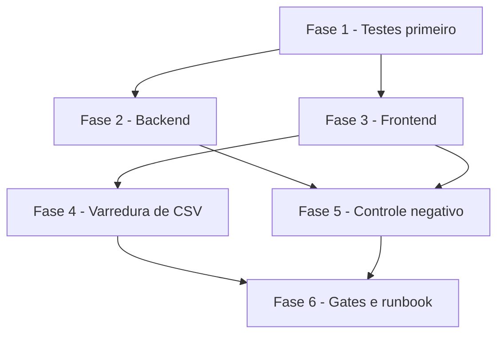

# Tarefas envioMassa_homologacao - Retorno da Transfeera em XLSX

Escopo: substituir o leitor CSV do retorno da Transfeera por leitor XLSX (21 colunas) em adiantamento e repasse, atravessando proxy, backend e frontend. Fonte: `spec.md` (FR-001..FR-019), `plan.md` (D1..D10), `checklists/requirements.md`. Sem migration, sem dependencia nova, sem `docker build` nesta frente (disco abaixo do gate; o build e do operador apos o merge).

**Legenda de status:**
- `[ ]` Pendente
- `[~]` Em andamento
- `[x]` Concluido
- `[!]` Bloqueado

**Legenda de criticidade:**
- `[C]` Critico - Impacto financeiro direto ou bloqueante
- `[A]` Alto - Funcionalidade essencial
- `[M]` Medio - Necessario mas sem urgencia imediata

**Regras transversais (valem para todas as tarefas):**
- Testes ANTES da edicao (FASE 1 antes das FASES 2-4): o controle negativo so vale se os testes existem contra o codigo atual.
- Teste novo entra SEMPRE em um dos 4 arquivos backend ja listados no `npm test` (`adiantamento-retorno-transfeera-unit`, `adiantamento-retorno-transfeera-arquivo-real`, `hub-adiantamentos-rotas-unit`, `hub-repasse-lotes-rotas-unit`) ou nos arquivos de frontend ja existentes; nenhum arquivo de teste novo.
- Dedup: reusar `extrairIdSolicitacao`, `casarComItensDoLote`, `deduplicarPorIdIntegracao`, `RetornoTransfeeraParseError`, `STATUS_DESCONHECIDO:` e `rotuloIgnorada`; proibido criar segundo mecanismo de recusa, handler de 413 novo ou aceitar os dois formatos.
- A fixture `backend/tests/fixtures/retorno-transfeera-21col-exemplo.xlsx` ja esta anonimizada: NAO anonimizar, NAO regerar, NAO ler nada de `/root`. Fixture nova so sintetica do zero.
- `git add` por caminho explicito; nunca `-A`/`.`. Nunca editar `docs/briefing.md`. Nenhuma escrita em producao.
- Baselines: backend `node --test` 1956 pass / 0 fail (389 suites); frontend lint 28 problemas (5 erros, 23 avisos).

---

## FASE 1 - Testes primeiro (vermelho contra o codigo atual)

### 1.1 Baseline e caracterizacao de `paraCentavos` `[C]`

Ref: plan D5, FR-008.

- [x] 1.1.1 Rodar `node --test` no backend e confirmar a baseline (1956 pass / 0 fail); anotar os numeros do inicio da execucao
- [x] 1.1.2 Escrever em `adiantamento-retorno-transfeera-unit.test.js` o teste de caracterizacao com tabela congelada de entradas->saidas atuais (inteiros, `0`, negativos, `54,57`, `54.57`, `1.005`->101, `8.165`->817, `2.675`->268, `1e3`, numero nativo, string com espacos)
- [x] 1.1.3 Rodar a caracterizacao contra o codigo atual e relatar que passa ANTES da mudanca (evidencia de que o ramo novo nao altera entradas existentes)
- [x] 1.1.4 Escrever o teste do ramo novo: `1.234,56`->123456, `-1.234,56`->-123456, `12.345.678,9`->1234567890; `abc`, vazio, `1.2.3,4`, `R$ 1.234,56`->`NaN`; `1.234` continua 123 centavos

### 1.2 Testes do leitor `lerXlsx` e do casamento (lib) `[C]`

Ref: plan D2, D3, D4, FR-003..FR-011, FR-014.

- [x] 1.2.1 Em `adiantamento-retorno-transfeera-unit.test.js`: criar o helper `montarXlsx(linhas)` (`XLSX.write` em memoria, so no teste) no lugar de `csvEscape/montarCsv`; remover `describe('lerCsv')` e `describe('lerCsv — leitor RFC4180 proprio')`; migrar os blocos de casamento/duplicata/prefixo REP de `lerCsv(montarCsv(..))` para `lerXlsx(montarXlsx(..))`
- [x] 1.2.2 Teste do cabecalho: ler o cabecalho da fixture e comparar com `CABECALHO_ESPERADO` (21 colunas, incluindo `Tipo de Conta (Corrente ou Poupança)`); casos ausente, extra, fora de ordem e renomeada -> `CABECALHO_INVALIDO` antes de interpretar linhas
- [x] 1.2.3 Testes de formato: buffer vazio, binario qualquer, texto renomeado, ZIP corrompido, CSV, HTML -> `FORMATO_INVALIDO` (magic `PK\x03\x04`); sem aba -> `FORMATO_INVALIDO`; so cabecalho -> `ARQUIVO_VAZIO`
- [x] 1.2.4 Teste do teto de descompressao: ZIP em memoria com tamanho declarado > 32 MiB (e outro com > 100 entradas) -> `ARQUIVO_MUITO_GRANDE`; EOCD ausente / ZIP64 -> `FORMATO_INVALIDO`. Nomear o teste da "bomba" (usado na mutacao 5.1.3)
- [x] 1.2.5 Testes de linhas: 10.005 linhas de dados -> `ARQUIVO_MUITO_GRANDE`; linhas em branco finais ignoradas; so a primeira aba lida
- [x] 1.2.6 Teste de celula vazia no meio da linha: a coluna continua existindo pelo cabecalho, nao pelo conteudo (FR-004). Nomear o teste (usado na mutacao 5.1.4)
- [x] 1.2.7 Testes de tipos de celula: texto `"54,57"`, numero nativo `54.57`, formula (so o valor em cache, nada executado), celula com texto de instrucao tratada como texto (FR-010)
- [x] 1.2.8 Testes de status: `FINALIZADO`, `Finalizada` -> efetivado; `Devolvida` -> ramo de devolucao com motivo literal (US3-AS4); `XYZ` -> `STATUS_DESCONHECIDO:XYZ` e lote nao confirmado
- [x] 1.2.9 Teste FR-014: status de 5.000 caracteres com `<script>` e controle `\u0000` -> motivo com no maximo 40 caracteres apos o prefixo, sem `<`, `>` nem controle. Nomear o teste (usado na mutacao 5.1.2)
- [x] 1.2.10 Teste SC-004: arquivo sintetico de 10.000 linhas montado no teste; medir `lerXlsx` + `casarComItensDoLote` com `process.hrtime`; assert < 5 s e o numero entra no relato

### 1.3 Testes do arquivo real (fixture) `[C]`

Ref: SC-001, SC-003, US1.

- [x] 1.3.1 Reescrever `adiantamento-retorno-transfeera-arquivo-real.test.js` sobre a fixture: 58 linhas, `ADV-000015` a `ADV-000074`, todas `FINALIZADO`, 58 de 58 aplicados, reenvio idempotente (US1-AS1/AS2). Nomear o teste 58/58 (usado na mutacao 5.1.1)
- [x] 1.3.2 Conferir por inspecao, e relatar, que a fixture nao traz nome/CPF/CNPJ reais antes do `git add` (so verificar, nunca alterar)

### 1.4 Testes das DUAS rotas de backend `[C]`

Ref: plan D4, FR-001, FR-002, FR-005, FR-013, FR-019; `hub-adiantamentos.js:1471`, `hub-repasse-lotes.js:523`.

- [x] 1.4.1 Em `hub-adiantamentos-rotas-unit.test.js` (1346-1400, 1821-1836): trocar `csvRetornoTexto` por `xlsxRetorno()` devolvendo `Buffer` com `contentType: XLSX_MIME`; conferir `Content-Length` por `Buffer.byteLength` no helper `request`
- [x] 1.4.2 Em `hub-repasse-lotes-rotas-unit.test.js` (62, 281-338): mesmo tratamento (`csv()` -> `xlsxRetorno()`), com IDs `REP-...`; caso `ADV-...` em lote de repasse -> nenhuma linha aplicada (US2-AS2)
- [x] 1.4.3 Nas duas rotas: `Content-Type` `text/csv`, `text/plain`, `application/octet-stream` e ausente -> 400 `{erro:'ARQUIVO_INVALIDO', motivo:'FORMATO_INVALIDO'}`; corpo > 10 MB -> status 413 (paridade documentada com a rota CSV anterior, CHK020); permissao e modulo ainda recusam ANTES do parser
- [x] 1.4.4 Nas duas rotas: efeitos de negocio inalterados (confirmacao do lote, falhas, auditoria, idempotencia, bloqueio de confirmacao parcial) e log do `catch` sem `e.message` do SheetJS (so mensagem constante + `e.name`)

### 1.5 Testes de frontend: proxy, retry e dialog `[C]`

Ref: plan D1, D6, FR-012, FR-016..FR-018.

- [x] 1.5.1 Em `app/api/[...path]/route.test.ts`: corpo com bytes `0x80..0xFF` e `PK\x03\x04` chega ao `fetch` mockado byte a byte identico. Nomear o teste (usado na mutacao 5.1.5); deve FALHAR contra o proxy atual (entrega string com U+FFFD)
- [x] 1.5.2 Em `route.test.ts`: `content-length` ausente/invalido -> 411; > 10 MB -> 413 `ARQUIVO_MUITO_GRANDE`; afirmar que `req.arrayBuffer` NAO foi chamado nesses casos; mime comparado por igualdade apos `split(';')[0].trim()` (um mime parecido com `spreadsheetml.sheet` no meio do valor nao entra no ramo)
- [x] 1.5.3 Em `route.test.ts` (CHK012 a): 401 com corpo binario XLSX -> o proxy renova a sessao e REENVIA o mesmo buffer; o `fetch` mockado recebe os mesmos bytes nas duas chamadas
- [x] 1.5.4 Em `route.test.ts` (CHK012 b, teste distinto do anterior): 401 com corpo `multipart/form-data` continua NAO reenviando (uma unica chamada ao `fetch`)
- [x] 1.5.5 Em `route.test.ts`: um endpoint nao-XLSX (JSON) continua recebendo `init.body` string (regressao do caminho existente)
- [x] 1.5.6 Em `adiantamento-importar-retorno-dialog.test.tsx` e `repasse-lote-dialogs-reuso.test.tsx`: `importar` mockado recebe `ArrayBuffer` com `byteLength` igual a `File.size` (contra o dialog atual recebe `string`); `accept` contem `.xlsx`; rotulo "Arquivo XLSX"; mensagens novas `CABECALHO_INVALIDO` e `FORMATO_INVALIDO`; arquivo > 10 MB barrado antes do envio
- [x] 1.5.7 Nos `page.test.tsx` do lote/repasse que citam CSV: atualizar os textos esperados **[sem alteracao: nenhum `page.test.tsx` cita o CSV do retorno; o unico "Exportar CSV" do repasse e outro recurso]**

### 1.6 Registro do vermelho `[C]`

Ref: SC-003, plan D8 passo 1.

- [x] 1.6.1 Rodar os 4 arquivos backend e o `vitest` dos arquivos de frontend tocados contra o codigo AINDA nao editado; registrar nome a nome a lista de testes que FALHAM (esperado: todos os que usam a fixture, `lerXlsx`, `XLSX_MIME`, o proxy e o dialog) e confirmar que falham pelo motivo certo, nao por erro de import/sintaxe do teste

---

## FASE 2 - Backend

### 2.1 Milhar brasileiro em `paraCentavos` `[C]`

Ref: plan D5, FR-008; `lib/adiantamento-remanescente.js:33`.

- [x] 2.1.1 Adicionar UM ramo antes do fallback, so para o padrao `/^(-?)(\d{1,3}(?:\.\d{3})+),(\d+)$/` (remove os pontos e reentra no caminho existente); nenhum outro caminho muda
- [x] 2.1.2 Rodar a caracterizacao (1.1.2) e o teste do ramo (1.1.4) e a suite dos arquivos chamadores (`adiantamento-remanescente`, `adiantamento-dto`, `adiantamento-transfeera-xlsx`, `hub-repasse-lotes`, `hub-adiantamentos`, retorno); relatar os numeros

### 2.2 Leitor `lerXlsx` e status em `lib/adiantamento-retorno-transfeera.js` `[C]`

Ref: plan D2, D3; FR-003, FR-004, FR-006, FR-009..FR-011, FR-014.

- [x] 2.2.1 Implementar `lerXlsx(buffer)` com o pipeline do plan D2 na ordem barato->caro: buffer nao vazio, magic `PK\x03\x04`, teto de descompressao (EOCD, 32 MiB, 100 entradas), `XLSX.read` com `sheetRows` e opcoes sem formula/HTML/estilos, primeira aba, dimensao `!fullref`, `sheet_to_json({header:1, raw:true, defval:'', blankrows:false})`, cabecalho por `JSON.stringify`, indices das 4 colunas resolvidos uma vez
- [x] 2.2.2 `CABECALHO_ESPERADO` com as 21 colunas exportado; `STATUS_CONHECIDOS = {FINALIZADO, Finalizada, Devolvida}` (plan D3 prevalece); `rotuloStatus` (`replace` + `slice(0, 40)`) usado dentro de `casarComItensDoLote` para montar `STATUS_DESCONHECIDO:`; exportar `XLSX_MIME`
- [x] 2.2.3 Remover `lerCsv`, `dividirCsvRfc4180`, o ramo `codigoErro` de `motivoLiteral` e a coluna `Codigo de erro` de `normalizarLinha` (codigo morto); manter o restante listado no plan D2
- [x] 2.2.4 Rodar os testes das tarefas 1.2 e 1.3 e relatar passando, com o numero de SC-004

### 2.3 As duas rotas: `express.raw` e leitura binaria `[C]`

Ref: plan D4, FR-019. As duas rotas importam o leitor com o alias `lerCsv: lerRetornoTransfeeraCsv`; a renomeacao atravessa AS DUAS na mesma tarefa.

- [x] 2.3.1 `routes/hub-adiantamentos.js` (import `:71`, rota `:1471`, corpo/erro `:1478-1490`): trocar o alias `lerRetornoTransfeeraCsv` por `lerXlsx`; `express.text` -> `express.raw({ limit: '10mb', type: [XLSX_MIME] })` na propria rota, depois de `requireModuloAtivo` + `requirePermission` + `retornoRateLimiter`; corpo nao-Buffer/vazio -> 400 `ARQUIVO_INVALIDO/FORMATO_INVALIDO`; `catch` loga so constante + `e.name`; atualizar o comentario do topo (nao e mais `text/csv`)
- [x] 2.3.2 `routes/hub-repasse-lotes.js` (import `:40`, rota `:523`, corpo/erro `:530-540`): exatamente as mesmas mudancas, importando `XLSX_MIME` do lib (constante unica)
- [x] 2.3.3 Conferir por `grep` que nao sobrou `lerCsv`/`lerRetornoTransfeeraCsv`/`express.text` de retorno em nenhuma rota, e que o `express.json()` global nao foi tocado
- [x] 2.3.4 Rodar os testes de 1.4 e relatar passando

### 2.4 Script manual do operador `[M]`

Ref: plan D8; `backend/scripts/verificar-retorno-transfeera-real.js`.

- [x] 2.4.1 Fazer o script ler `.xlsx` via `lerXlsx` (mesmo objetivo, sem deixar caminho CSV vivo); nao ler arquivo do operador nem de `/root` durante a execucao desta frente

### 2.5 Valor ambiguo `1.234` na borda do retorno `[C]`

Ref: spec FR-020, plan D5.bis; `lib/adiantamento-retorno-transfeera.js`, `adiantamento-importar-retorno-dialog.tsx`.

- [x] 2.5.1 `normalizarLinha` marca `valorAmbiguoTexto` (`^-?\d{1,3}(?:\.\d{3})+$`); `casarComItensDoLote` emite `VALOR_AMBIGUO:<texto saneado>` antes de `VALOR_DIVERGENTE`; `paraCentavos` intocada
- [x] 2.5.2 Rotulo em `rotuloIgnorada` (prefixo `VALOR_AMBIGUO:`) dizendo o que fazer; teste no dialog
- [x] 2.5.3 Teste (`1.234`, `12.345`) e contraprova (`1.234,56`, `54,57`) em `adiantamento-retorno-transfeera-unit.test.js`; controle negativo: com o ramo desligado caem os 2 testes novos (+1 por efeito colateral do formato)

---

## FASE 3 - Frontend (proxy, API, dialog)

### 3.1 Proxy: ramo binario XLSX com tetos `[C]`

Ref: plan D1, FR-016, FR-017; `app/api/[...path]/route.ts:103`.

- [x] 3.1.1 Novo ramo restrito ao mime XLSX (igualdade apos `split(';')[0].trim()`): antes de ler o corpo, `content-length` ausente/invalido -> 411 e `> 10 MB` -> 413 com `{erro:'ARQUIVO_INVALIDO', motivo:'ARQUIVO_MUITO_GRANDE'}`; senao `init.body = new Uint8Array(await req.arrayBuffer())`; reusar a constante de 10 MB; nenhum outro endpoint muda
- [x] 3.1.2 Rodar os testes 1.5.1, 1.5.2 e 1.5.5 e relatar passando

### 3.2 Proxy: retry apos 401 com corpo binario `[C]`

Ref: plan D1, FR-018; CHK012.

- [x] 3.2.1 `corpoReenviavel` passa a aceitar `Uint8Array`; `multipart` (stream) continua nao reenviavel
- [x] 3.2.2 Rodar os DOIS testes: 1.5.3 (binario reenvia) e 1.5.4 (multipart nao reenvia); relatar cada um separadamente, pois cobrem defeitos distintos

### 3.3 `adiantamentos-api.ts` e dialog compartilhado `[A]`

Ref: plan D6, FR-012, FR-015.

- [x] 3.3.1 `lib/hub/adiantamentos-api.ts`: exportar `XLSX_MIME`; `importarRetornoLote(id, xlsx: ArrayBuffer)` e `importarRetornoLoteRepasse(id, xlsx: ArrayBuffer)` via helper privado `postarRetorno(path, xlsx)` (`POST`, header `Content-Type: XLSX_MIME`, `body: xlsx`)
- [x] 3.3.2 `adiantamento-importar-retorno-dialog.tsx`: `importar?: (id, xlsx: ArrayBuffer)`; `arquivo.text()` -> `await arquivo.arrayBuffer()` (nunca `text()`); `accept` com `.xlsx` e o mime; `CSV_MAX_BYTES` -> `XLSX_MAX_BYTES = 10 * 1024 * 1024`; rotulo "Arquivo XLSX"; frase informativa reescrita sem afirmar menu da Transfeera; `MOTIVO_ARQUIVO.CABECALHO_INVALIDO` reescrito e `FORMATO_INVALIDO` novo (textos do plan D6); comentarios do topo atualizados; `rotuloIgnorada` e `MOTIVO_IGNORADA` inalterados
- [x] 3.3.3 Conferir que os chamadores do dialog (adiantamento e repasse) acompanham a nova assinatura; rodar os testes 1.5.6 e 1.5.7 e `tsc --noEmit`

---

## FASE 4 - Varredura de CSV na Central de Ajuda e textos

### 4.1 `lib/hub/ajuda-conteudo.json` e HTMLs gerados `[M]`

Ref: plan D7, FR-015.

- [x] 4.1.1 MUDAM (11 mencoes previstas; **10 efetivamente alteradas**, ver plan 'Reconciliacao' item 3; mencoes da Transfeera, medidas por caminho JSON; confirmar cada caminho antes de editar, pois indices podem ter deslocado): `.secoes[2].blocos[1].passos[5].texto`; `.secoes[12].blocos[2].itens[0]`; `.secoes[12].blocos[3].texto`; `.secoes[12].blocos[4].texto`; `.secoes[12].blocos[7].texto`; `.secoes[22].blocos[7].texto`; `.secoes[22].blocos[8].itens[0]`; `.secoes[23].blocos[1].linhas[4][2]`; `.secoes[24].blocos[0].linhas[3][0]`; `.secoes[25].blocos[3].texto` (reescrever so o TEXTO, sem adicionar blocos: o teste da ajuda quebra se o JSON ganhar bloco que a tela nao renderiza)
- [x] 4.1.2 NAO MUDAM (outro importador; trocar qualquer uma e defeito): `.secoes[7].blocos[1].itens[3]` ("Exportar CSV" da Validacao XML); `.secoes[16].blocos[1].texto` (`.csv`/`.zip` ate 20 MB, Faturamento EntreGo); `.secoes[16].blocos[2].itens[2]` (CSV de erros, EntreGo). CASO-ARMADILHA: `.secoes[22].blocos[10].itens[0]` ("`.csv` ou `.zip` com um unico CSV; ate 20 MB") esta na mesma secao 22 da Transfeera mas parece ser do importador do EntreGo: ler o bloco inteiro da secao 22 e identificar a qual importador pertence ANTES de tocar; se for EntreGo, fica intocado
- [x] 4.1.3 REMOVER a afirmacao velha do caminho de menu ("portal da Transfeera › Transferencias › Exportar CSV") nos 4 pontos que a trazem (`.secoes[12].blocos[2].itens[0]`, `.secoes[22].blocos[8].itens[0]`, `.secoes[23].blocos[1].linhas[4][2]`, `.secoes[25].blocos[3].texto`): deixa-la mandaria o financeiro exportar justamente o arquivo que o sistema passa a recusar. Nao inventar nem deduzir um caminho novo
- [x] 4.1.4 No lugar do caminho, descrever o arquivo pelo CONTRATO verificavel: extensao `.xlsx`, 21 colunas, coluna `ID integração` preenchida com o `ADV-...`/`REP-...` do hub (e o que faz o casamento); acrescentar a consequencia medida: sobrescrever essa coluna a mao no arquivo de ENVIO faz a Transfeera devolver o texto trocado e o casamento falhar (ocorreu com o arquivo real do operador). Registrar o caminho de menu como pendencia declarada para o operador confirmar (ele baixou o arquivo e sabe o caminho)
- [x] 4.1.5 Localizar o gerador existente dos HTMLs compartilhaveis e regenerar a partir do JSON (nunca editar o HTML publicado); relatar o que foi regenerado; rodar o teste da ajuda **[N/A: o repo so tem gerador HTML do guia do APP MOTORISTA (`docs/manuais/app-motorista/gerar.py`, outro JSON); a ajuda do hub nao tem HTML gerado versionado]**
- [x] 4.1.6 `grep -rni "csv"` nos arquivos tocados desta frente e relatar cada ocorrencia restante como intencional (ex.: importador de Faturamento) ou corrigida

---

## FASE 5 - Controle negativo (5 mutacoes, testes nomeados)

### 5.1 Mutar, relatar NOME A NOME, reverter `[C]`

Ref: plan D8 passo 2, SC-003, CHK032. Para cada mutacao: aplicar, rodar a suite, anotar os NOMES dos testes que caem (relatar "algum teste caiu" NAO cumpre a tarefa), reverter e confirmar verde. Se o teste esperado nao cair, o teste esta oco: corrigir o teste antes de seguir.

- [x] 5.1.1 Mutacao (a): tirar `FINALIZADO` de `STATUS_CONHECIDOS` -> deve cair o teste 58/58 nomeado em 1.3.1
- [x] 5.1.2 Mutacao (b): tirar o `.slice`/`.replace` de `rotuloStatus` -> deve cair o teste FR-014 nomeado em 1.2.9
- [x] 5.1.3 Mutacao (c): desligar o teto de descompressao -> deve cair o teste da "bomba" nomeado em 1.2.4
- [x] 5.1.4 Mutacao (d): comparar o cabecalho/colunas por conteudo da linha em vez de por posicao -> deve cair o teste da celula vazia no meio nomeado em 1.2.6
- [x] 5.1.5 Mutacao (e): remover o ramo `spreadsheetml` do proxy -> deve cair o teste de bytes nomeado em 1.5.1
- [x] 5.1.6 Confirmar que, apos reverter as 5, `git diff` do codigo de producao e identico ao de antes das mutacoes e a suite esta verde

---

## FASE 6 - Gates, runbook e fechamento

### 6.1 Gates numericos `[C]`

Ref: plan "Gates"; regras do rito do ciclo git do repo.

- [x] 6.1.1 Backend: `node --test` completo: baseline 1956 pass / 0 fail + os novos, `0 fail`; `node scripts/checar-testes-orfaos.js` limpo e contagem de testes por arquivo (nenhum virou oco) **[`checar-testes-orfaos` acusa `notas-pendentes-corte-unit.test.js`: PRE-EXISTENTE (commit 60ccf5a, #280), fora desta frente]**
- [x] 6.1.2 Frontend do hub: `tsc --noEmit`, `vitest run`, `next build` (so apos `df -h /` e swap conferidos; abortar se < ~20 GB livres e devolver ao operador), lint comparado com a baseline (28 problemas: 5 erros, 23 avisos; erro novo bloqueia)
- [x] 6.1.3 Detector impeccable com 0 achados no dialog tocado; grep nos `tests/e2e-hub-browser` por spec que cubra o dialog de retorno e relatar se ha ou nao **[detector: 0 achados no dialog; nenhum spec e2e cobre o dialog de retorno]**
- [x] 6.1.4 `git diff --stat package-lock.json` vazio nos dois pacotes (o container do Playwright o reescreve: conferir e reverter); nenhuma dependencia nova (SC-005)
- [x] 6.1.5 NAO rodar `docker build` nesta frente (disco em ~19 GB, abaixo do gate de 20 GB); relatar `df -h /` como esta

### 6.2 Runbook de deploy para o operador `[A]`

Ref: plan D10, CHK039.

- [x] 6.2.1 Escrever o runbook de deploy em `docs/specs/retorno-transfeera-xlsx/quickstart.md` (artefato; o operador executa): backend primeiro, frontend_v2 na mesma janela, rollback pelas imagens anteriores dos dois servicos (anotar via `docker service ls`), sem migration e sem `SIGUSR1`
- [x] 6.2.2 O runbook contem, em UMA linha explicita: "nao importar retorno durante a janela de deploy" (um frontend antigo enviando `text/csv` recebe 400 `FORMATO_INVALIDO`); registrar tambem que 413 acima de 10 MB sai como HTML do Express (paridade, aceito) e que o `Devolvida` e o unico rotulo do ramo de devolucao (se aparecer outro, `STATUS_DESCONHECIDO:` nomeia e o operador envia a amostra)
- [x] 6.2.3 O runbook traz as provas pos-deploy: frontend pela STRING servida (ex.: `Arquivo XLSX` no chunk do dialog), backend interrogando o processo vivo (`XLSX_MIME` no arquivo da imagem em execucao), e que o smoke funcional com arquivo real em lote real e do operador

---

## Matriz de Dependencias

## Resumo Quantitativo

| Fase | Tarefas | Subtarefas | Criticidade |
|------|---------|------------|-------------|
| 1 - Testes primeiro | 6 | 30 | C |
| 2 - Backend | 4 | 12 | C |
| 3 - Frontend | 3 | 8 | C |
| 4 - Varredura de CSV | 1 | 6 | M |
| 5 - Controle negativo | 1 | 6 | C |
| 6 - Gates e runbook | 2 | 8 | C |
| **Total** | **17** | **70** | - |

## Escopo Coberto

| Item | Descricao | Fase |
|------|-----------|------|
| FR-001, FR-002, FR-019 | Corpo binario nas duas rotas, CSV recusado | 1.4, 2.3 |
| FR-003, FR-004, FR-009..FR-011 | Leitor XLSX, cabecalho por posicao, tetos, falhas claras | 1.2, 2.2 |
| FR-005, FR-013 | Casamento por ID e efeitos de negocio inalterados | 1.4, 2.3 |
| FR-006, FR-014 | Tres rotulos de status, valor desconhecido saneado | 1.2, 2.2 |
| FR-007 | Motivo literal repassado | 1.2.8 |
| FR-008 | Milhar brasileiro sem regredir entradas existentes | 1.1, 2.1 |
| FR-012, FR-015 | Dialog, API e varredura de textos CSV | 1.5, 3.3, 4.1 |
| FR-016, FR-017, FR-018 | Proxy binario, tetos 411/413, retry com binario e multipart nao reenviavel | 1.5, 3.1, 3.2 |
| SC-001, SC-003, SC-004, SC-005 | Fixture 58/58, controle negativo, 10.000 linhas, sem dependencia nova | 1.3, 5.1, 1.2.10, 6.1 |
| Deploy | Runbook com janela, rollback e provas | 6.2 |

## Escopo Excluido

| Item | Descricao | Motivo |
|------|-----------|--------|
| Handler de erro do 413 | Resposta JSON para corpo > 10 MB no `express.raw` | CHK020 aceito: paridade com a rota CSV anterior; seria escopo inventado |
| Aceitar CSV e XLSX | Manter `lerCsv` para cobrir a janela de deploy | Operador decidiu substituir; seria codigo morto (CHK039) |
| "20 MB", `.zip`, "Exportar CSV" da Validacao XML, CSV de erros | Mencoes da ajuda que pertencem a Faturamento (EntreGo) e Validacao XML | Outros importadores, fora de escopo |
| Caminho de menu novo da Transfeera | Onde baixar o XLSX | Nao medido (Constituicao VI); o velho sai, o novo e pendencia do operador |
| Rotulos de status nao medidos | `DEVOLVIDO` e afins | Proibido adivinhar; `STATUS_DESCONHECIDO:` nomeia o valor |
| Anonimizacao/regeracao da fixture | Trabalho sobre a amostra | Ja feita e provada por diff; original com PII fica fora do repo |
| `docker build` e deploy | Imagens e `service update` | Disco abaixo do gate; e do operador apos o merge |
